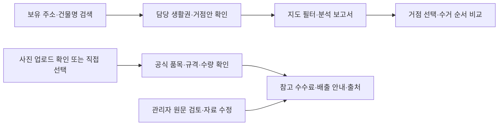

<div align="center">

# ♻️ GREENZONE

### 신월1동 생활권 기반 분산 수거 거점 분석과 배출 안내

**건물 검색으로 담당 거점안을 확인하고, 배치 조건·수거 경로·품목별 배출 정보를 살펴보는 웹 서비스**

`Python` · `FastAPI` · `Kakao Maps` · `Leaflet / Folium` · `SQLite`

[프로젝트 소개](#1-프로젝트-개요) · [데이터](#2-데이터셋) · [분석 결과](#5-분석-결과) · [주요 기능](#6-웹-서비스-구현) · [실행 방법](#8-실행-방법)

</div>

> **교육 프로젝트 · 진행 중 / 문서 기준: 2026-10-21**  
> 대상은 **서울특별시 양천구 신월1동의 아파트 제외 주거 필지**입니다. 지도 거점과 수거 경로는 운영 승인 전 분석 제안입니다.

---

## 1. 프로젝트 개요

### 추진 배경과 목적

주거지역의 공동 배출 공간을 검토할 때는 주민이 이동할 거리와 수거 차량의 작업 조건을 함께 살펴봐야 합니다. 배출 방법을 안내하는 정보와 거점 위치를 분석하는 자료를 실제 주소와 연결하는 과정도 필요합니다.

그린존은 건물·도로·보호시설 자료로 **생활권과 거점 후보를 비교**하고, 그 결과를 주민의 건물 검색과 연결합니다. 선택 거점을 방문하는 수거 경로안을 살펴보고, 별도 배출 안내 화면에서 공식 품목·규격·수수료를 확인할 수 있도록 구성했습니다.

### 서비스 이용 흐름



지도의 제안 거점은 대형폐기물의 공식 배출장소로 자동 지정되지 않습니다. 실제 신고와 결제는 지자체 공식 사이트에서 진행합니다.

## 2. 데이터셋

### 현재 분석 대상

| 항목 | 현재 팀 2차 결과 |
|---|---:|
| 주거 필지 | 1,585필지 |
| 등록 주거단위 | 7,193 |
| 생활권 | 9개 |
| 거점안 | 9곳 = 기존 후보에서 선택한 6곳 + 새 대안 3곳 |
| 웹 수거 경로용 도로 | 1차 결과에서 받은 162구간 |

**등록 주거단위는 건축물대장의 세대수·가구수를 가공한 값입니다. 실제 거주 인구나 관측 배출량을 뜻하지 않습니다.**

### 데이터 출처와 사용 목적

| 데이터 | 출처 | 사용 목적·기준 |
|---|---|---|
| 행정동 경계 | SGIS 기반 행정동 경계 가공본 | 신월1동 분석 범위. 버전·좌표계는 원본별 명세 참고 |
| 건축물대장·도로명주소 전자지도 | 국토교통부·행정안전부 자료를 이용한 팀 분석 | 지번 연결, 주거단위 정리, 도로망·생활권·거점안 산출 |
| 보호시설·주차장·공원 | 공공데이터포털 표준데이터를 이용한 팀 분석 | 1차 후보와 대안의 접근성·보호시설 이격 검토 |
| 2차 분석 결과·엑셀·GeoJSON | [팀 분석 코드와 결과](https://github.com/Han-think/greenzone_ai/tree/930e1b2d291c888cee84ae284b6d830e3d4b322e/greenzone_data_analysis/greenzone2nd) | 2026-10-20 작성 결과. 웹은 받은 분석 결과를 연결 |
| 권역별 생활폐기물 배출량 | [양천구 공식 공개자료](https://www.data.go.kr/data/15093944/fileData.do) | 웹에서는 2024년 신월1·2·3·5동 결합권역 값과 조건부 추정을 구분 |
| 대형폐기물 품목·수수료 | [스마트클린 양천](https://smartclean.yangcheon.go.kr/online/bulky/item) | 91품목·163별칭·268규칙. 2026-10-18 확인 스냅샷, 현행 금액 재대조 필요 |
| 법령·배출 절차 | [국가법령정보센터](https://law.go.kr/LSW/ordinInfoP.do?ordinSeq=2176939)·[양천구 공식 안내](https://smartclean.yangcheon.go.kr/online/bulky/guide) | 관련 조문 발췌 4건·절차 요약 1건. 2026-10-21 확인, 시행일은 문서별 보존 |

자료마다 기준시점이 다릅니다. **분석 작성일·원자료 기준일·확인일·법령 시행일을 구분**합니다. 원문에 없는 날짜는 임의로 채우지 않습니다.

파일별 출처·기준시점·SHA256·사용 상태는 [데이터 목록](data/data_inventory.csv), 데이터 버전과 원본 보관 위치는 [데이터 안내](data/README.md)를 참고합니다.

## 3. 데이터 정제와 탐색

다음 과정은 **팀이 작성한 2차 분석 보고서 기준**입니다. 현재 웹에서 전체 분석을 다시 실행한 결과가 아닙니다.

| 단계 | 처리 내용 | 목적 |
|---|---|---|
| 범위 선택 | 건물과 신월1동 경계를 공간 연결 | 다른 행정동을 분석 대상에서 제외 |
| 지번 연결 | 표제부와 전자지도 건물을 지번 키로 연결 | 이름이 비슷한 건물을 추측 연결하지 않음 |
| 아파트 제외 | 아파트로 분류된 필지 제외 | 이번 프로젝트의 대상 범위로 한정 |
| 주거단위 정리 | 세대수 + 가구수, 팀 기준에 따른 주거용도 0값 보정 | 주거 수요의 대리값 생성 |
| 상가주택 반영 | 근린생활시설 중 주거단위가 있는 건물 포함 | 주용도만으로 주거 수요를 누락하지 않도록 처리 |
| 필지 통합 | 같은 지번의 건물을 필지 단위로 묶음 | 1,585필지·7,193 등록 주거단위로 정리 |

주거 밀집도는 등록 주거단위를 이용해 해석합니다. 과거 결합권역 배출량을 현재 필지나 거점별 실측 배출량으로 바꾸어 표현하지 않습니다.

## 4. 분석 방법

### 생활권과 거점안

1. **도로거리 계산**: 도로 중심선 그래프로 필지 사이의 접근 거리를 계산합니다.
2. **생활권 구분**: 도로거리·등록 주거단위를 반영한 그래프에 Louvain을 적용합니다. 팀의 선택 설정은 연결 반경 150m, 해상도 γ=1입니다.
3. **후보 연결**: 생활권 안에 1차 후보가 있으면 후보를 비교하고, 없는 생활권에는 새 대안 지점을 탐색합니다.
4. **조건 검토**: 등록 도로폭 7m 이상·보호시설 반경 200m 밖 등의 분석 조건을 사용합니다.
5. **결과 비교**: 평균 거리·상위 10% 지점의 거리·최대 거리·기준 거리 안 비율을 비교합니다.

150m·7m·200m는 이번 분석의 설정입니다. 법적 설치 승인이나 현장 안전 판정으로 사용하지 않습니다. **9곳은 1차 후보 11곳을 필터링해 9곳만 남긴 결과가 아닙니다.**

### 수거 경로안

- **자동 순서**: 구간별 도로 최단거리(다익스트라)를 계산한 뒤 가까운 미방문 거점부터 연결합니다.
- **직접 순서**: 사용자가 1번부터 방문 순서를 정하고, 정한 순서 사이를 도로 최단거리로 연결합니다.
- **공통 조건**: 방문 거점·도로 등록폭·출발 거점·출발지 복귀 여부를 선택합니다. 연결할 수 없는 경우 사유를 표시합니다.

웹 경로는 받은 도로 162구간으로 만든 별도 경로안입니다. 팀 2차 보고서의 수거 순회거리 재현값과 구분합니다.

## 5. 분석 결과

### 생활권·거점 지도

<p align="center">
  
</p>

그림은 팀의 2차 결과 원본입니다. 그림에 쓰인 '세대'는 이 README에서 설명한 **등록 주거단위**로 해석합니다. 새 대안의 부지와 실제 운영 조건은 확인이 필요합니다.

### 접근 거리 비교

아래 값은 [팀 결과 엑셀](data/received/team_second_stage/greenzone2nd.xlsx)의 `안 비교` 시트를 [화면용 요약 JSON](data/processed/team_second_stage_summary.json)으로 옮긴 값입니다.

| 비교안 | 평균 거리 | 거리 90백분위 | 최대 거리 | 300m 이내 비율 |
|---|---:|---:|---:|---:|
| 기존 후보 중 6곳 | 226.1m | 348.9m | 576.9m | 79.1% |
| 9곳 · 가장 가까운 거점 이용 | 172.6m | 273.9m | 394.6m | 95.3% |
| **9곳 · 자기 생활권 담당 거점 이용** | **195.2m** | **334.8m** | **474.8m** | **84.1%** |
| 1차 후보 11곳 전부 | 212.1m | 336.2m | 470.4m | 82.7% |

- 주민의 건물 검색은 **자기 생활권 담당 거점**을 안내합니다. 가장 가까운 거점을 이용한다고 가정한 비교 수치와 섞지 않습니다.
- 300m 이내 비율은 팀 보고서의 등록 주거단위 기준입니다. 실제 주민 이용률이나 수거 실적이 아닙니다.
- 거리는 팀 도로망 기반 추정입니다. 실제 보행로·횡단 조건을 현장에서 검증한 값은 아닙니다.

<details>
<summary>생활권 분석의 설정별 민감도 그림 펼치기</summary>


오른쪽 그래프는 부지 제약을 무시한 **이상적 중심**의 접근성입니다. 최종 제안 거점의 실제 접근성 표와 구분합니다. 설정별 해석은 [팀 분석 보고서](data/received/team_second_stage/greenzone2nd.md)를 참고합니다.

</details>

## 6. 웹 서비스 구현

| 화면·기능 | 현재 코드에 반영한 내용 |
|---|---|
| 주소·건물 검색 `/` | 보유 도로명·지번·건물명 검색, 10개씩 더보기, 담당 생활권·거점안과 직선거리 표시 |
| 후보·지도 필터 `/` | 6곳/9곳 비교, 필지·1차 후보·대안·도로·보호시설 표시 조건 |
| 수거 경로 `/?view=route` | 거점 선택, 자동/직접 방문 순서, 등록폭 조건, 복귀 선택, 경로·구간거리·방문 번호 |
| Leaflet `/analysis` | 받은 분석 자료를 체크하며 보는 지도 |
| Folium `/analysis/folium` | 선택 조건으로 Python이 보고용 HTML 지도를 생성 |
| 사진·배출 안내 `/disposal` | 사진 형식 확인·미리보기 삭제, 공식 품목·규격·수량 수동 선택, 참고 금액·공식 신청 링크 |
| 관리자 `/admin` | 로그인·로그아웃, 기존 자료 수정·사용 중지, 출처·날짜·검토 상태, 수정 사유와 이전/새 값 이력 |

사진은 JPG·PNG·WebP 정지 사진 1장, 8MB·1,200만 화소 이하를 받으며 서버에 저장하지 않습니다. **현재 자동 품목 인식은 연결하지 않았습니다.** 사진 없이 직접 선택할 수도 있습니다.

관리자 수정값은 `data/local/service.sqlite3`에 저장하고 다음 사용자 조회에 반영하도록 연결했습니다. 미검토 안내 문서는 확정 근거로 노출하지 않습니다. 원본 JSON은 보존합니다.

> 현재 상태는 **코드 반영 및 문법 검토**입니다. 최신 통합본의 실제 브라우저 동작·사진 업로드·관리자 수정 반영은 별도 확인이 필요합니다. 자동 테스트와 외부 AI 호출은 수행하지 않았습니다.

## 7. 기술 구성과 폴더 구조

| 구분 | 기술·역할 |
|---|---|
| 서버 | Python, FastAPI, Uvicorn |
| 화면 | Jinja2, HTML, CSS, JavaScript |
| 지도 | Kakao Maps JavaScript SDK, Leaflet, Folium |
| 배출 자료 저장 | Python 내장 SQLite, JSON 초기 자료 |
| 이미지 파일 확인 | Pillow — 자동 인식 모델이 아닌 실제 형식·픽셀 확인 도구 |
| 분석 결과 | 팀 Louvain·도로망 분석 결과 및 보고서·GeoJSON 연결 |
| 이후 연결 예정 | 외부 Vision API, LLM·RAG·임베딩, Opik |

```text
greenzone_ai/
├── main.py                 # 기존 지도·검색 API와 새 서비스 연결
├── route_planner.py        # 자동/직접 순서의 도로 경로 계산
├── folium_report.py        # 분석 보고용 HTML 지도
├── guide_service.py        # 초기 자료·SQLite 조회·관리자 수정 이력
├── service_routes.py       # 사진·배출 안내·관리자 API
├── templates/              # 지도·분석·배출 안내·관리자 HTML
├── static/                 # 화면별 JavaScript·CSS
├── data/
│   ├── received/            # 받은 팀 결과·엑셀·보고서·과거 자료
│   ├── raw/                # 보유 공공자료·API 응답 원본
│   ├── analysis/           # 배출량·수요 분석과 추정 근거
│   ├── processed/          # 화면 요약·주소 보완·경로 그래프
│   ├── knowledge/          # 품목·규칙·법령·공식 원문·출처
│   └── local/              # 실행 중 생성되는 관리자 DB, Git 제외
├── docs/HANDBOOK.md         # 코드 흐름·출처·한계·관리 절차
├── requirements.txt
└── .env.example            # 개인 설정 예제, 실제 .env는 Git 제외
```

## 8. 실행 방법

### ① 저장소 받기·패키지 설치

Windows PowerShell에서 실행합니다. 이미 받은 프로젝트는 해당 폴더에서 설치 단계부터 진행합니다.

```powershell
git clone https://github.com/Han-think/greenzone_ai.git
cd greenzone_ai
python -m venv .venv
.venv\Scripts\python.exe -m pip install -r requirements.txt
if (!(Test-Path .env)) { Copy-Item .env.example .env }
```

### ② 개인 환경변수 설정

`.env`를 열어 아래 값을 입력합니다. 실제 키·비밀번호는 공유하지 않습니다.

```dotenv
KAKAO_JAVASCRIPT_KEY=
ADMIN_USERNAME=admin
ADMIN_PASSWORD=
```

- **카카오 키**: [Kakao Developers](https://developers.kakao.com/)에서 앱의 **JavaScript 키**를 확인합니다. Java 키·REST API 키와 구분합니다.
- **지도 설정**: 해당 앱의 카카오맵 사용 설정을 확인하고 허용 웹 도메인에 `http://localhost:8000`을 등록합니다.
- **관리자**: 각자 `ADMIN_PASSWORD`를 16자 이상으로 지정합니다. 미설정·16자 미만이면 관리자 로그인을 허용하지 않습니다. 자동 생성된 공용 계정은 없습니다.
- 지도 클릭의 좌표→주소 변환은 같은 카카오 키를 사용합니다. 보유 건물 검색에는 별도 API 키가 없습니다.
- 현재 실행에 Docker·Ollama·VWorld·LLM 키는 필요하지 않습니다.
- **사진 품목 후보**: [Google AI Studio API Keys](https://aistudio.google.com/apikey)에서 Gemini API 키를 발급해 `GEMINI_API_KEY`에 입력합니다. 키는 서버의 `.env`에만 두며, 키가 없으면 기존 직접 품목 선택 방식이 그대로 동작합니다.
- 모델에 일시적인 `503` 과부하가 반복되면 `GEMINI_MODEL=gemini-2.5-flash-lite` 또는 `GEMINI_MODEL=gemini-2.5-flash`로 바꿔 다른 멀티모달 모델을 시험하고 서버를 재시작합니다. 프로젝트·계정에 따라 무료 사용 가능 모델과 한도가 다르므로 AI Studio의 모델별 한도를 확인하세요.
- 키를 설정한 상태에서 `/disposal`의 사진 업로드 버튼을 누르면 사진이 Google Gemini API로 전송됩니다. 서버는 사진을 파일로 저장하지 않습니다. Gemini 요청의 구조화 출력 스키마에서 품목 ID·이름을 현재 등록 목록으로 제한하고, 서버도 목록에 없는 후보를 제외합니다. 규격·수량·수수료는 기존대로 사용자가 직접 확인합니다. Google AI Studio 사용량·요금·데이터 정책을 확인한 뒤 사용하세요.
- 기존 Python 의존성 외에 Gemini SDK를 설치할 필요는 없습니다. 서버에서 Google Gemini REST API를 호출합니다.

### ③ 서버 실행

```powershell
.venv\Scripts\python.exe -m uvicorn main:app --host localhost --port 8000 --reload --no-access-log
```

| 접속 주소 | 화면 |
|---|---|
| http://localhost:8000/ | 건물 검색·후보 지도 |
| http://localhost:8000/?view=route | 수거 경로 도구 펼치기 |
| http://localhost:8000/analysis | Leaflet 분석 지도 |
| http://localhost:8000/analysis/folium | Folium 분석 보고서 |
| http://localhost:8000/disposal | 사진·품목별 배출 안내 |
| http://localhost:8000/admin | 관리자 로그인 |

<details>
<summary>실행·공유 시 알아둘 점</summary>

- 카카오 허용 도메인과 접속 주소를 같은 `localhost:8000`으로 맞춥니다. `127.0.0.1:8000`은 별도 등록 주소입니다.
- 기존 가상환경도 `python -m pip install -r requirements.txt`로 갱신합니다. 환경변수·데이터를 바꿨으면 서버를 재시작합니다.
- 지도 SDK·배경 지도를 불러오려면 인터넷 연결이 필요합니다. API 키·도메인 제한도 확인합니다.
- 배출 안내 DB는 첫 조회 때 생성됩니다. 관리자 세션은 단일 서버 프로세스에서 8시간 유지되며 재시작하면 해제됩니다.
- `.env`, `data/local/`, 가상환경, 사진은 Git 공유 대상이 아닙니다. 관리자 DB 백업은 서버를 멈춘 뒤 별도로 복사합니다.
- `.gitattributes`는 데이터의 줄바꿈 변환을 막아 원본 SHA256을 보존합니다.
- 이미 팀 코드 작업 중이면 로컬 변경을 보관한 후 최신 master와 비교해 통합합니다.

</details>

## 9. 현재 한계와 남은 작업

| 구분 | 현재 한계·다음 단계 |
|---|---|
| 후보·안전성 | 등록 도로폭과 분석 가정에 따른 제안. 현장 유효폭·정차·보행·부지 동의 확인 필요 |
| 분석 재현 | 원본 표제부·도로/건물 SHP·중간 거리행렬을 모두 보유하지 않아 전체 분석 재실행 미완료 |
| 수거 경로 | 양방향 도로망 근사. 차고지·일방통행·회전·정차·부지 진입 미반영, 전역 최적 경로 보장 없음 |
| 배출량 | 결합권역 공식값과 조건부 추정. 신월1동/거점별 실측량으로 해석하지 않음 |
| 수수료·법령 | 수수료 스냅샷 최신 대조, 별표 상세 금액 비교, 신월1동 품목별 상세 요일 확인 필요 |
| 이미지 인식 | 업로드·수동 확인 기반 구현. 외부 Vision 모델 선택과 자동 분류 연결 필요 |
| LLM·RAG | 공식 자료 저장·DB 조회 기반 준비. 임베딩·문서 검색·LLM 답변·Opik 평가 미연결 |
| 운영 확인 | 최신 화면·업로드·로그인·수정 반영 확인 및 여러 서버용 세션 구성 필요 |

이 프로젝트의 결과는 **분석안 비교와 서비스 연결 가능성**입니다. 실제 수거 시간·연료·비용·안전 개선 효과를 검증한 결과는 아닙니다.

## 10. 팀 협업과 상세 문서

분석은 **원본·정제 기준·거점 결과·선정 근거**, 개발은 **검색·지도·배출 안내·관리 화면**, 통합은 **데이터 버전과 화면 수치의 일치·문서·진행 상태**를 함께 확인합니다.

- 팀 분석 결과와 웹 코드의 출처·통합 이력은 [핸드북](docs/HANDBOOK.md)에 남겼습니다. 팀원의 기존 결과와 코드 흐름을 유지하며 연결합니다.
- 공통 개발 기준은 `master`이며 새 작업은 별도 작업 브랜치에서 진행합니다.
- [데이터 안내](data/README.md): 현재·과거 버전, 원본 위치, 도로 자료와 재현 범위.
- [파일별 데이터 목록](data/data_inventory.csv): 출처·기준시점·해시·연결 상태.
- [팀 2차 분석 보고서](data/received/team_second_stage/greenzone2nd.md): 정제·생활권·후보 선정의 상세 설명.
- [개발·관리 핸드북](docs/HANDBOOK.md): 코드/API 흐름, 법령 자료, 관리자 저장, 후속 작업.

