<div align="center">

# ♻️ GREENZONE

### 신월1동 생활권 기반 분산 수거 거점 분석과 배출 안내

**건물 검색으로 담당 거점안을 확인하고, 배치 조건·수거 경로·품목별 배출 정보를 살펴보는 웹 서비스**

`Python` · `FastAPI` · `Kakao Maps` · `Leaflet / Folium` · `SQLite`

[프로젝트 소개](#1-프로젝트-개요) · [데이터](#2-데이터셋) · [분석 결과](#5-분석-결과) · [주요 기능](#6-웹-서비스-구현) · [실행 방법](#8-실행-방법)

[프로젝트 주장·근거 기록](docs/GREENZONE_ARGUMENT_EVIDENCE_20261022.md) — 추진 배경부터 팀 분석·구현·검증·발표 문답까지 연결한 확장 초안

</div>

> **교육 프로젝트 · 진행 중 / 문서 기준: 2026-10-23**<br>
> 대상은 **서울특별시 양천구 신월1동의 아파트 제외 주거 필지**입니다. 지도 거점과 수거 경로는 운영 승인 전 분석 제안입니다.

---

## 1. 프로젝트 개요

### 추진 배경과 목적

주거지역의 공동 배출 공간을 검토할 때는 주민이 이동할 거리와 수거 차량의 작업 조건을 함께 살펴봐야 합니다. 배출 방법을 안내하는 정보와 거점 위치를 분석하는 자료를 실제 주소와 연결하는 과정도 필요합니다.

그린존은 건물·도로·보호시설 자료로 **생활권과 거점 후보를 비교**하고, 그 결과를 주민의 건물 검색과 연결합니다. 선택 거점을 방문하는 수거 경로안을 살펴보고, 별도 배출 안내 화면에서 공식 품목·규격·수수료를 확인할 수 있도록 구성했습니다.

### 서비스 이용 흐름

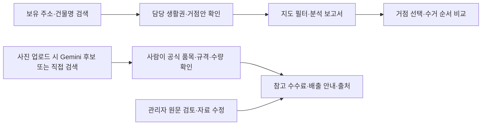

지도의 제안 거점은 대형폐기물의 공식 배출장소로 자동 지정되지 않습니다. 실제 신고와 결제는 지자체 공식 사이트에서 진행합니다.

## 2. 데이터셋

### 현재 분석 대상

| 항목 | 현재 팀 2차 결과 |
|---|---:|
| 주거 필지 | 1,585필지 |
| 등록 주거단위 | 7,193 |
| 생활권 | 9개 |
| 거점안 | 9곳 = 기존 후보에서 선택한 6곳 + 새 대안 3곳 |
| 웹 수거 경로용 도로 | 1차 결과에서 받은 162구간 |

**등록 주거단위는 건축물대장의 세대수·가구수를 가공한 값입니다. 실제 거주 인구나 관측 배출량을 뜻하지 않습니다.**

### 데이터 출처와 사용 목적

| 데이터 | 출처 | 사용 목적·기준 |
|---|---|---|
| 행정동 경계 | SGIS 기반 행정동 경계 가공본 | 신월1동 분석 범위. 버전·좌표계는 원본별 명세 참고 |
| 건축물대장·도로명주소 전자지도 | 국토교통부·행정안전부 자료를 이용한 팀 분석 | 지번 연결, 주거단위 정리, 도로망·생활권·거점안 산출 |
| 보호시설·주차장·공원 | 공공데이터포털 표준데이터를 이용한 팀 분석 | 1차 후보와 대안의 접근성·보호시설 이격 검토 |
| 2차 분석 결과·엑셀·GeoJSON | [팀 분석 코드와 결과](https://github.com/Han-think/greenzone_ai/tree/930e1b2d291c888cee84ae284b6d830e3d4b322e/greenzone_data_analysis/greenzone2nd) | 2026-10-20 작성 결과. 웹은 받은 분석 결과를 연결 |
| 권역별 생활폐기물 배출량 | [양천구 공식 공개자료](https://www.data.go.kr/data/15093944/fileData.do) | 웹에서는 2024년 신월1·2·3·5동 결합권역 값과 조건부 추정을 구분 |
| 대형폐기물 품목·수수료 | [스마트클린 양천](https://smartclean.yangcheon.go.kr/online/bulky/item) | 91품목·163별칭·268규칙. 2026-10-18 확인 스냅샷, 현행 금액 재대조 필요 |
| 법령·배출 절차 | [국가법령정보센터](https://law.go.kr/LSW/ordinInfoP.do?ordinSeq=2176939)·[양천구 공식 안내](https://smartclean.yangcheon.go.kr/online/bulky/guide) | 관련 조문 발췌 4건·절차 요약 1건. 2026-10-21 확인, 시행일은 문서별 보존 |

자료마다 기준시점이 다릅니다. **분석 작성일·원자료 기준일·확인일·법령 시행일을 구분**합니다. 원문에 없는 날짜는 임의로 채우지 않습니다.

파일별 출처·기준시점·SHA256·사용 상태는 [데이터 목록](data/data_inventory.csv), 데이터 버전과 원본 보관 위치는 [데이터 안내](data/README.md)를 참고합니다.

## 3. 데이터 정제와 탐색

다음 과정은 **팀이 작성한 2차 분석 보고서 기준**입니다. 현재 웹에서 전체 분석을 다시 실행한 결과가 아닙니다.

| 단계 | 처리 내용 | 목적 |
|---|---|---|
| 범위 선택 | 건물과 신월1동 경계를 공간 연결 | 다른 행정동을 분석 대상에서 제외 |
| 지번 연결 | 표제부와 전자지도 건물을 지번 키로 연결 | 이름이 비슷한 건물을 추측 연결하지 않음 |
| 아파트 제외 | 아파트로 분류된 필지 제외 | 이번 프로젝트의 대상 범위로 한정 |
| 주거단위 정리 | 세대수 + 가구수, 팀 기준에 따른 주거용도 0값 보정 | 주거 수요의 대리값 생성 |
| 상가주택 반영 | 근린생활시설 중 주거단위가 있는 건물 포함 | 주용도만으로 주거 수요를 누락하지 않도록 처리 |
| 필지 통합 | 같은 지번의 건물을 필지 단위로 묶음 | 1,585필지·7,193 등록 주거단위로 정리 |

주거 밀집도는 등록 주거단위를 이용해 해석합니다. 과거 결합권역 배출량을 현재 필지나 거점별 실측 배출량으로 바꾸어 표현하지 않습니다.

## 4. 분석 방법

### 생활권과 거점안

1. **도로거리 계산**: 도로 중심선 그래프로 필지 사이의 접근 거리를 계산합니다.
2. **생활권 구분**: 도로거리·등록 주거단위를 반영한 그래프에 Louvain을 적용합니다. 팀의 선택 설정은 연결 반경 150m, 해상도 γ=1입니다.
3. **후보 연결**: 생활권 안에 1차 후보가 있으면 후보를 비교하고, 없는 생활권에는 새 대안 지점을 탐색합니다.
4. **조건 검토**: 등록 도로폭 7m 이상·보호시설 반경 200m 밖 등의 분석 조건을 사용합니다.
5. **결과 비교**: 평균 거리·상위 10% 지점의 거리·최대 거리·기준 거리 안 비율을 비교합니다.

150m·7m·200m는 이번 분석의 설정입니다. 법적 설치 승인이나 현장 안전 판정으로 사용하지 않습니다. **9곳은 1차 후보 11곳을 필터링해 9곳만 남긴 결과가 아닙니다.**

### 수거 경로안

- **자동 순서**: 구간별 도로 최단거리(다익스트라)를 계산한 뒤 가까운 미방문 거점부터 연결합니다.
- **직접 순서**: 사용자가 1번부터 방문 순서를 정하고, 정한 순서 사이를 도로 최단거리로 연결합니다.
- **공통 조건**: 방문 거점·도로 등록폭·출발 거점·출발지 복귀 여부를 선택합니다. 연결할 수 없는 경우 사유를 표시합니다.

웹 경로는 받은 도로 162구간으로 만든 별도 경로안입니다. 팀 2차 보고서의 수거 순회거리 재현값과 구분합니다.

## 5. 분석 결과

### 생활권·거점 지도

<p align="center">
  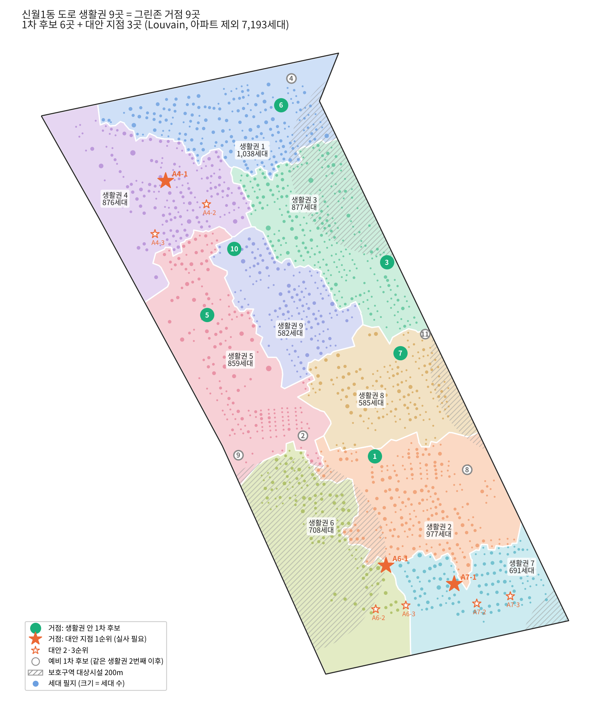
</p>

그림은 팀의 2차 결과 원본입니다. 그림에 쓰인 '세대'는 이 README에서 설명한 **등록 주거단위**로 해석합니다. 새 대안의 부지와 실제 운영 조건은 확인이 필요합니다.

### 접근 거리 비교

아래 값은 [팀 결과 엑셀](data/received/team_second_stage/greenzone2nd.xlsx)의 `안 비교` 시트를 [화면용 요약 JSON](data/processed/team_second_stage_summary.json)으로 옮긴 값입니다.

| 비교안 | 평균 거리 | 거리 90백분위 | 최대 거리 | 300m 이내 비율 |
|---|---:|---:|---:|---:|
| 기존 후보 중 6곳 | 226.1m | 348.9m | 576.9m | 79.1% |
| 9곳 · 가장 가까운 거점 이용 | 172.6m | 273.9m | 394.6m | 95.3% |
| **9곳 · 자기 생활권 담당 거점 이용** | **195.2m** | **334.8m** | **474.8m** | **84.1%** |
| 1차 후보 11곳 전부 | 212.1m | 336.2m | 470.4m | 82.7% |

- 주민의 건물 검색은 **자기 생활권 담당 거점**을 안내합니다. 가장 가까운 거점을 이용한다고 가정한 비교 수치와 섞지 않습니다.
- 300m 이내 비율은 팀 보고서의 등록 주거단위 기준입니다. 실제 주민 이용률이나 수거 실적이 아닙니다.
- 거리는 팀 도로망 기반 추정입니다. 실제 보행로·횡단 조건을 현장에서 검증한 값은 아닙니다.

<details>
<summary>생활권 분석의 설정별 민감도 그림 펼치기</summary>

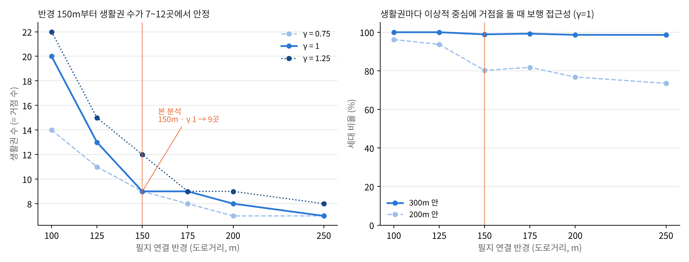

오른쪽 그래프는 부지 제약을 무시한 **이상적 중심**의 접근성입니다. 최종 제안 거점의 실제 접근성 표와 구분합니다. 설정별 해석은 [팀 분석 보고서](data/received/team_second_stage/greenzone2nd.md)를 참고합니다.

</details>

## 6. 웹 서비스 구현

| 화면·기능 | 현재 코드에 반영한 내용 |
|---|---|
| 주소·건물 검색 `/` | 보유 도로명·지번·건물명 검색, 10개씩 더보기, 담당 생활권·거점안과 직선거리 표시 |
| 후보·지도 필터 `/` | 6곳/9곳 비교, 필지·1차 후보·대안·도로·보호시설 표시 조건 |
| 수거 경로 `/?view=route` | 거점 선택, 자동/직접 방문 순서, 등록폭 조건, 복귀 선택, 경로·구간거리·방문 번호 |
| 분석 지도 `/analysis` | 한 페이지에서 Leaflet 필터 탐색 / Folium Python 보고 지도 전환 |
| 사진·배출 안내 `/disposal` | Gemini 품목 후보→사용자 규격·수량 선택→DB 참고 금액, 추가 질문→임베딩 검색·Gemini 근거 답변·출처·날짜 |
| 관리자 `/admin` | 로그인·로그아웃, 기존 자료 수정·사용 중지, 출처·날짜·검토 상태, 수정 사유와 이전/새 값 이력 |

사진은 JPG·PNG·WebP 정지 사진 1장, 8MB·1,200만 화소 이하를 받습니다. 촬영정보(EXIF)를 제거하고 긴 변을 1,280픽셀 이하로 줄여 Google Gemini에 보냅니다. 사진은 서버 파일·DB·Opik에 저장하지 않습니다. Google 측 처리·보관 조건은 해당 서비스 정책을 확인해야 합니다.

Gemini는 현재 DB의 공식 품목 ID·이름 중 최대 3개를 제안합니다. 서버에서 허용된 ID만 다시 검사하며, 후보 버튼을 **사용자가 눌러야** 해당 품목이 선택됩니다. 규격·수량을 직접 확인한 뒤 DB 금액을 조회합니다. 사진만으로 크기·수량·요금·배출장소를 확정하지 않습니다.

키가 없거나 분석이 실패하거나 후보가 없을 때에도 직접 검색할 수 있습니다. 분석 오류와 후보 없음(보류)을 구분합니다. DINO·YOLO는 서비스 업로드 요청에 연결하지 않았으며 아래 비교 근거에 연구 결과를 보존했습니다.

관리자는 `.env` 계정으로 로그인해 수수료·안내 문서의 설명·출처·확인일·시행일·사용 상태를 수정합니다. 수정값은 `data/local/service.sqlite3`에 저장되고 **다음 사용자 조회부터 반영**됩니다. 원본 JSON은 보존하고 이전/새 값·사유·수정 시각을 남깁니다. 이미 열려 있는 사용자 결과는 다시 조회해야 갱신됩니다.

### 화면으로 보는 이용 방법

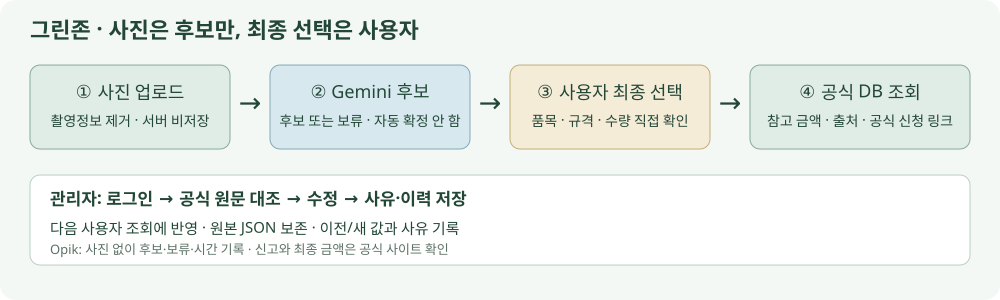

| 순서 | 실제 사용 방법 |
|---|---|
| 1 | `/disposal`에서 사진을 고르고 **AI 품목 후보 확인**을 누릅니다. 사진 없이 품목 검색으로 시작해도 됩니다. |
| 2 | 후보 설명을 참고해 실제 물건과 맞는 **품목 선택 버튼**을 누릅니다. 틀린 후보는 채택하지 않고 직접 검색합니다. |
| 3 | 규격·수량을 직접 선택하고 **선택한 규격으로 안내 보기**를 누릅니다. 출처·기준일·참고 금액을 확인한 뒤 공식 신고 사이트로 이동합니다. |
| 4 | `/admin`에서 로그인 → 자료 검색 → 원문 대조 → 수정 사유 작성 → 저장합니다. 사용자 화면을 다시 조회해 반영을 확인합니다. |

<details>
<summary>실제 로컬 실행 캡처 보기</summary>

**Gemini 후보 → 사용자 선택**. 후보 설명은 AI의 참고 설명이며 정답 보장이 아닙니다.

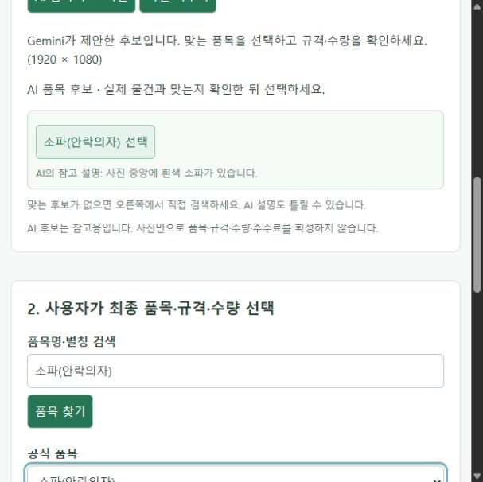

**사용자가 선택한 규격의 DB 금액 조회**. 예시는 2인용 소파 1개이며, 2026-10-18 스냅샷 기준의 참고값입니다.

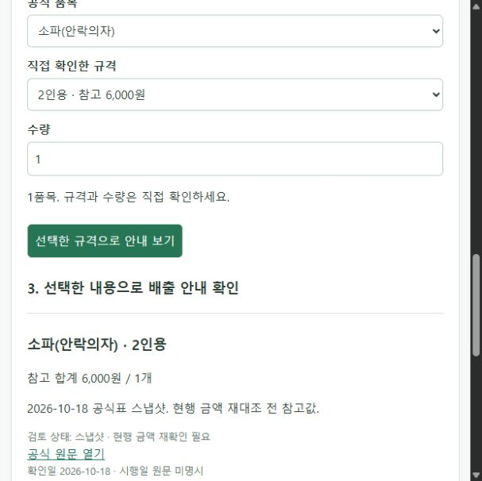

**관리자 자료 관리 화면**. 비밀번호는 캡처·문서에 넣지 않았습니다.

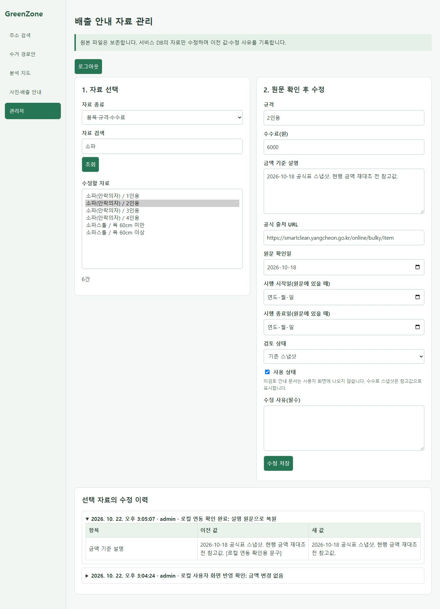

**이전/새 값과 사유**. 화면 반영 테스트에서 설명만 바꾸고 원문으로 복원했으며 금액은 변경하지 않았습니다.

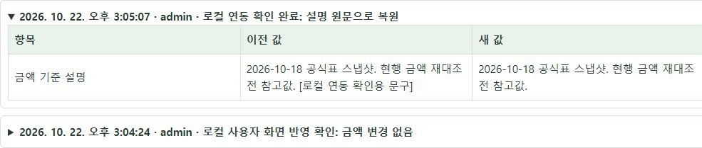

</details>

### 확인한 동작과 남은 범위

2026-10-22 로컬 `localhost:8000`에서 브라우저의 사진 업로드·Gemini 후보·사용자 품목/규격 선택·참고 금액 조회·관리자 로그인·설명 수정·사용자 반영·원복·한국어 이력을 확인했습니다. 추가 실제 HTTP 점검 **18건 통과**: 권한 차단, 로그인/로그아웃, 잘못된 입력 거부, DB 금액×수량, 수정 버전 충돌 등입니다.

Opik은 선택 설정 시 서비스의 실제 후보/보류/오류·관측 처리시간·토큰 사용량을 기록합니다. 사진·API 키·주소·검색어는 기록하지 않습니다. 기존 75건은 **사후 등록 실험**, 이후 `서비스실호출` 태그는 **웹에서 실제 호출한 기록**입니다. Opik 장애가 품목 수동 조회를 막지 않습니다.

**2026-10-22~23 로컬 RAG 연결:** 검토된 공식 문서를 LangChain으로 분할하고 `gemini-embedding-001`로 검색한 뒤 Gemini가 구조화된 JSON 답변을 반환합니다. 기존 배출 화면의 **4. 배출 방법이 더 궁금한가요?**에서 질문·답변·공식 출처·확인일/시행일을 봅니다. 금액은 확정 규격의 DB 계산, 규격 부족·근거 부족은 확인 요청, API 실패는 오류로 구분합니다.

문서 색인은 `data/local/rag_index/`에 보관하며 첫 관련 질문 때 만들고, 관리자 변경·검토 상태·시행일 등 입력 지문이 달라지면 다음 질문에서 재구축합니다. 질문·사진은 색인에 저장하지 않습니다. 검색은 현재 검수 발췌 범위이며 실시간 웹검색이 아닙니다. JSON 형식과 인용 문단 ID를 검사하지만 답변 의미의 완전한 정확성을 보장하지는 않습니다.

**로컬 확인:** 질문 시나리오11건과 입력검사6건, 합계17건의 상태/DB금액 계약을 확인했습니다. 별도 핵심 검사9건은 임의 출처·생성 금액 차단, 선택 품목 불일치, 문서 변경 후 색인 갱신, 키/공급자 오류를 확인합니다. 이는 일반 정확도·환각률이 아닙니다. [실제 HTTP 결과](docs/rag_verification_20261022.json) · [Opik 저장 필드 확인](docs/rag_opik_verification_20261022.json) · [핵심 검사 코드](scripts/test_rag.py)

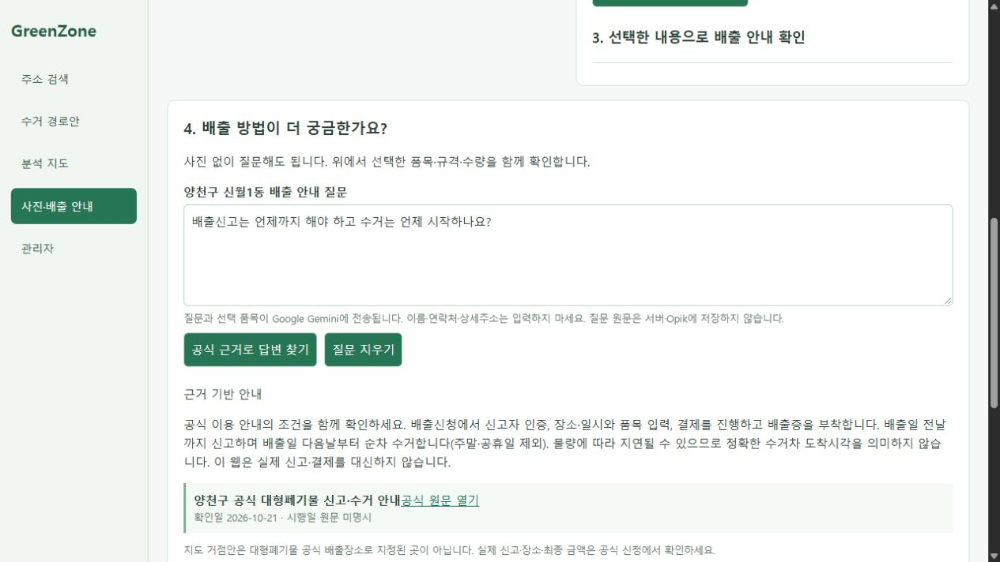

Opik에는 질문/사진/답변 원문 대신 상태·근거 ID·처리시간·측정 사용량만 기록합니다. 읽기 확인 시 완료된 기록4건을 확인했습니다. 개인정보가 있는 평가 ZIP은 사용하지 않았으며 별도 충돌 진단과 비식별 사진 평가는 남아 있습니다. 환각 자동심사와 사용자 최종 선택/수정률 자동 수집도 미실행입니다. 이미지 비교 수치를 그대로 서비스 정확도로 주장하지 않습니다.

## 7. 기술 구성과 폴더 구조

| 구분 | 기술·역할 |
|---|---|
| 서버 | Python, FastAPI, Uvicorn |
| 화면 | Jinja2, HTML, CSS, JavaScript |
| 지도 | Kakao Maps JavaScript SDK, Leaflet, Folium |
| 배출 자료 저장 | Python 내장 SQLite, JSON 초기 자료 |
| 이미지 파일 확인 | Pillow — 실제 형식·픽셀 확인과 전송 전 메타데이터 제거 |
| 가구 후보 | Gemini → 사용자 선택. 키가 없거나 오류/보류이면 직접 검색 |
| 분석 결과 | 팀 Louvain·도로망 분석 결과 및 보고서·GeoJSON 연결 |
| 관측·평가 | Opik 실호출 로그와 사후 비교 로그. 환각 자동심사는 미실행 |
| 근거 답변 | LangChain 문단 분할·Gemini 임베딩·JSON 응답. 독립 사진 평가는 별도 |

```text
greenzone_ai/
├── server/                 # 실행 진입점·공식 문서 RAG
├── main.py                 # 기존 지도·검색 API와 새 서비스 연결
├── route_planner.py        # 자동/직접 순서의 도로 경로 계산
├── folium_report.py        # 분석 보고용 HTML 지도
├── guide_service.py        # 초기 자료·SQLite 조회·관리자 수정 이력
├── service_routes.py       # 사진·배출 안내·관리자 API
├── vision_service.py        # 외부 Vision API의 가구 후보만 읽기
├── templates/              # 지도·분석·배출 안내·관리자 HTML
├── static/                 # 화면별 JavaScript·CSS
├── data/
│   ├── received/            # 받은 팀 결과·엑셀·보고서·과거 자료
│   ├── raw/                # 보유 공공자료·API 응답 원본
│   ├── analysis/           # 배출량·수요 분석과 추정 근거
│   ├── processed/          # 화면 요약·주소 보완·경로 그래프
│   ├── knowledge/          # 품목·규칙·법령·공식 원문·출처
│   └── local/              # 실행 중 생성되는 관리자 DB, Git 제외
├── docs/HANDBOOK.md         # 코드 흐름·출처·한계·관리 절차
├── requirements.txt
└── .env.example            # 개인 설정 예제, 실제 .env는 Git 제외
```

## 8. 실행 방법

[서버 폴더 실행·저장 구조·외부 서버 이전 설명](server/README.md) · 간단 실행: `.venv\Scripts\python.exe server/run.py`

### ① 저장소 받기·패키지 설치

Windows PowerShell에서 실행합니다. 이미 받은 프로젝트는 해당 폴더에서 설치 단계부터 진행합니다.

```powershell
git clone https://github.com/Han-think/greenzone_ai.git
cd greenzone_ai
python -m venv .venv
.venv\Scripts\python.exe -m pip install -r requirements.txt
if (!(Test-Path .env)) { Copy-Item .env.example .env }
```

### ② 개인 환경변수 설정

`.env`를 열어 아래 값을 입력합니다. 실제 키·비밀번호는 공유하지 않습니다.

```dotenv
KAKAO_JAVASCRIPT_KEY=
GEMINI_API_KEY=
GEMINI_MODEL=gemini-3.5-flash-lite
OPIK_ENABLED=false
OPIK_API_KEY=
OPIK_WORKSPACE=
OPIK_PROJECT_NAME=greenzone-vision-evaluation
ADMIN_USERNAME=admin
ADMIN_PASSWORD=
```

- **카카오 키**: [Kakao Developers](https://developers.kakao.com/)에서 앱의 **JavaScript 키**를 확인합니다. Java 키·REST API 키와 구분합니다.
- **지도 설정**: 해당 앱의 카카오맵 사용 설정을 확인하고 허용 웹 도메인에 `http://localhost:8000`을 등록합니다.
- **관리자**: 각자 `ADMIN_PASSWORD`를 16자 이상으로 지정합니다. 미설정·16자 미만이면 관리자 로그인을 허용하지 않습니다. 자동 생성된 공용 계정은 없습니다.
- 지도 클릭의 좌표→주소 변환은 같은 카카오 키를 사용합니다. 보유 건물 검색에는 별도 API 키가 없습니다.
- 현재 실행에 Docker·Ollama·VWorld·LLM 키는 필요하지 않습니다.

### Gemini·Opik 키 설정

- [Google AI Studio 키 발급](https://aistudio.google.com/api-keys)에서 받은 키 전체를 `GEMINI_API_KEY`에 입력합니다. 모델은 실제 확인한 `gemini-3.5-flash-lite`로 설정했습니다. 무료 한도·이용 가능 모델은 계정 상태에 따라 달라집니다.
- [Comet API 키 설정](https://www.comet.com/api/my/settings/)에서 받은 키를 `OPIK_API_KEY`에, Opik 주소의 워크스페이스명을 `OPIK_WORKSPACE`에 입력합니다. `OPIK_ENABLED=true`일 때 사진 없는 호출 결과를 기록합니다. 필요 없으면 `false`로 둡니다.
- 관리자 비밀번호는 `.env`의 `ADMIN_PASSWORD`에 16자 이상으로 설정합니다. 현재 로컬 계정 값은 문서에 공개하지 않습니다.
- `.env`를 변경하면 서버를 재시작합니다. 키를 브라우저 JavaScript나 Git에 넣지 않습니다.

### ③ 서버 실행

```powershell
.venv\Scripts\python.exe -m uvicorn main:app --host localhost --port 8000 --reload --no-access-log
```

| 접속 주소 | 화면 |
|---|---|
| http://localhost:8000/ | 건물 검색·후보 지도 |
| http://localhost:8000/?view=route | 수거 경로 도구 펼치기 |
| http://localhost:8000/analysis | Leaflet·Folium 통합 분석 지도 |
| http://localhost:8000/disposal | 사진·품목별 배출 안내 |
| http://localhost:8000/admin | 관리자 로그인 |

<details>
<summary>실행·공유 시 알아둘 점</summary>

- 카카오 허용 도메인과 접속 주소를 같은 `localhost:8000`으로 맞춥니다. `127.0.0.1:8000`은 별도 등록 주소입니다.
- 기존 가상환경도 `python -m pip install -r requirements.txt`로 갱신합니다. 환경변수·데이터를 바꿨으면 서버를 재시작합니다.
- 지도 SDK·배경 지도를 불러오려면 인터넷 연결이 필요합니다. API 키·도메인 제한도 확인합니다.
- 배출 안내 DB는 첫 조회 때 생성됩니다. 관리자 세션은 단일 서버 프로세스에서 8시간 유지되며 재시작하면 해제됩니다.
- `.env`, `data/local/`, 가상환경, 사진은 Git 공유 대상이 아닙니다. 관리자 DB 백업은 서버를 멈춘 뒤 별도로 복사합니다.
- `.gitattributes`는 데이터의 줄바꿈 변환을 막아 원본 SHA256을 보존합니다.
- 이미 팀 코드 작업 중이면 로컬 변경을 보관한 후 최신 master와 비교해 통합합니다.

</details>

## 9. 현재 한계와 남은 작업

| 구분 | 현재 한계·다음 단계 |
|---|---|
| 후보·안전성 | 등록 도로폭과 분석 가정에 따른 제안. 현장 유효폭·정차·보행·부지 동의 확인 필요 |
| 분석 재현 | 원본 표제부·도로/건물 SHP·중간 거리행렬을 모두 보유하지 않아 전체 분석 재실행 미완료 |
| 수거 경로 | 양방향 도로망 근사. 차고지·일방통행·회전·정차·부지 진입 미반영, 전역 최적 경로 보장 없음 |
| 배출량 | 결합권역 공식값과 조건부 추정. 신월1동/거점별 실측량으로 해석하지 않음 |
| 수수료·법령 | 수수료 스냅샷 최신 대조, 별표 상세 금액 비교, 신월1동 품목별 상세 요일 확인 필요 |
| 이미지 인식 | Gemini 실호출·사용자 선택 확인. 독립 사진의 검수와 오류율 평가 필요. 자동 확정 안 함 |
| LLM·RAG | 공식 문서 임베딩 검색·Gemini 구조화 답변·서버 출처 검증 연결. 로컬 동작 확인, 독립 평가와 환각 자동심사는 미완료 |
| 운영 확인 | 최신 화면·업로드·로그인·수정 반영 확인 및 여러 서버용 세션 구성 필요 |

이 프로젝트의 결과는 **분석안 비교와 서비스 연결 가능성**입니다. 실제 수거 시간·연료·비용·안전 개선 효과를 검증한 결과는 아닙니다.

## 10. 팀 협업과 상세 문서

분석은 **원본·정제 기준·거점 결과·선정 근거**, 개발은 **검색·지도·배출 안내·관리 화면**, 통합은 **데이터 버전과 화면 수치의 일치·문서·진행 상태**를 함께 확인합니다.

- 팀 분석 결과와 웹 코드의 출처·통합 이력은 [핸드북](docs/HANDBOOK.md)에 남겼습니다. 팀원의 기존 결과와 코드 흐름을 유지하며 연결합니다.
- 공통 개발 기준은 `master`이며 새 작업은 별도 작업 브랜치에서 진행합니다.
- [데이터 안내](data/README.md): 현재·과거 버전, 원본 위치, 도로 자료와 재현 범위.
- [파일별 데이터 목록](data/data_inventory.csv): 출처·기준시점·해시·연결 상태.
- [팀 2차 분석 보고서](data/received/team_second_stage/greenzone2nd.md): 정제·생활권·후보 선정의 상세 설명.
- [개발·관리 핸드북](docs/HANDBOOK.md): 코드/API 흐름, 법령 자료, 관리자 저장, 후속 작업.

## 11. 데이터 연결 ERD

실제 DB는 SQLite `records`·`history`·`seeds` 3테이블이고, GIS는 JSON/GeoJSON입니다. 자료 간 업무 관계를 이해하기 위한 **논리 ERD 11개 엔터티·14개 관계**를 별도로 제공합니다. 실제 서비스 DB를 새 구조로 바꾸지 않았습니다.

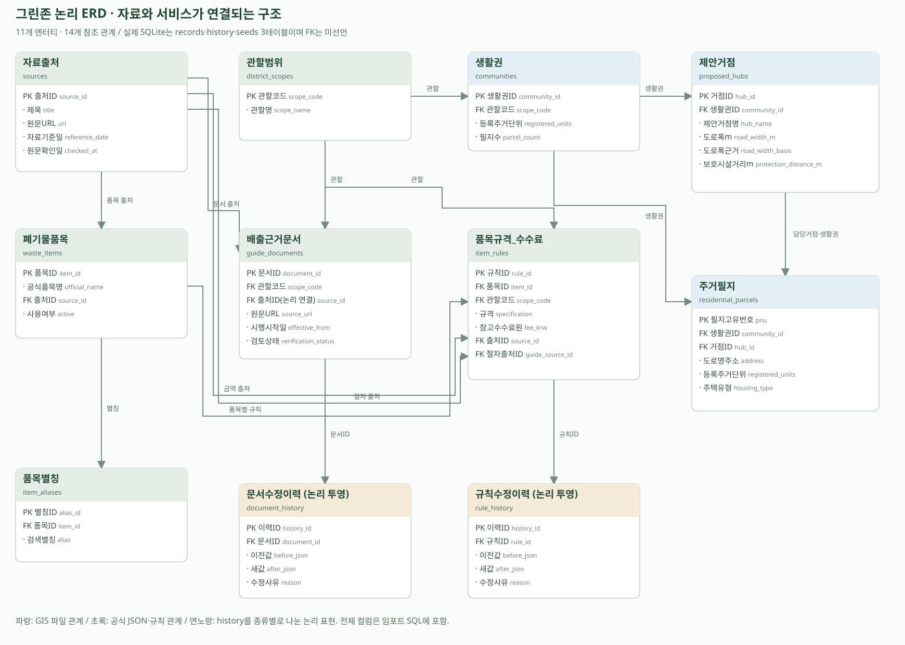

- [ERDCloud 임포트용 FK SQL](docs/erd/greenzone_logical_erd.sql)
- [실제 SQLite DDL](docs/erd/greenzone_current_sqlite.sql)
- [한글/영문 이름·실제 파일/DB 대응과 사용 방법](docs/erd/README.md)

임포트 SQL의 관계는 검증했지만 ERDCloud에서 실제 가져온 화면은 아직 확인하지 않았습니다. 논리 모델을 이미 구현된 물리 테이블로 발표하지 않습니다.

## 12. 현재 상태와 남은 배당

[갱신한 요구사항·통합현황·남은 작업 엑셀](docs/GreenZone_Requirements_Status_20261022.xlsx)

첨부 엑셀은 RAG 연결 전의 상태 스냅샷입니다. **현재 로컬에는 RAG API·질문 화면 연결과 개발 확인이 추가 완료**됐습니다. 엑셀의 RAG 미연결 표시는 후속 갱신 대상입니다. 다른 팀 PC 재현·독립 평가·발표 PDF는 남아 있으며, 전체 진행률을 임의 계산하지 않습니다.

| ID | 담당 | 남은 일 |
|---|---|---|
| R1 | 분석 | 시연 품목5개·질문10개 원문/정답 대조, 거점9개·수요 표본5건 최종 확인 |
| R2 | 개발 B | 로컬 연결·개발 확인 완료. 독립 질문 평가는 R4에서 수행 |
| R3 | 개발 A | 기존 배출 화면 질문·답변·출처 연결 및 브라우저 확인 완료 |
| R4 | 분석 + 개발 B | 질문10건의 값/출처/보류 평가와 Opik 점수 기록 |
| R5 | 개발 A | 주소5건·지도2보기·자동/직접 경로2건 회귀 확인 |
| R6 | PM + 개발 A/B | 다른 팀 PC 재현·최종 발표 PDF·시연/제출 목록 확정 |

R1 → R2 → R3 → R4 순서로 전달하고 R5는 병행합니다. R6에서 통합 확인합니다. 구현5일(10/20~24)과 기존 제출 마감(10/26 10시)을 유지하고 25일은 정리 여유로 둡니다.

공간 분석·사진·관리자·서버 진입·RAG 연결은 현재 로컬에 구현되어 있습니다. 이후에는 팀 내부 확인·독립 평가·다른 PC 재현·발표 PDF로 마무리합니다. [마무리 실행계획: 담당·입출력·일정·RAG·최종 PDF](docs/REMAINING_TASKS.md)

<details>
<summary>이미지 인식 방식 선정 근거와 비교 결과 상세</summary>

## 이미지 인식 방식 선정 근거 (2026-10-22)

**채택 방향: Gemini → 공식 품목 후보 → 사용자 최종 선택 → 공식 규격·수수료 DB 조회.**
사진만으로 크기·수량·요금·품목을 자동 확정하지 않습니다. 후보 없음, API 오류, 사용자가 수정한 경우를 각각 구분합니다.
아래 75건은 E의 독립 비교 실험 결과를 사후 등록한 자료입니다. 이후 D에는 Gemini 단독 업로드와 선택적 Opik 실호출 기록을 연결했으며 위 구현 화면에서 확인할 수 있습니다.

### 확대 비교 범위와 결과

기존 3장 시연 이후 **다른 사진 15장**을 추가했습니다. 실제 AI-Hub 가구 사진 12장(소파·침대·장롱·밥상·수납장·서랍장 원본 분류 각 2장, 분류별 서로 다른 촬영묶음)과 물건 없는 합성 대조 3장입니다.
합성 대조는 회색 단색·잡음·벽 색상의 단색 화면입니다. 자연사진이나 실제 주민 업로드 사진으로 부르지 않습니다.
Gemini 단독/DINO+Gemini 30회, 기존 YOLO 모델 3종 45회로 **총 75회** 추론했습니다. Opik에 사후 등록 후 75건을 다시 읽어 확인했습니다.

| 방식 | 요청 | 성공/오류 | 후보 없음 | 무물체 오제안 | 처리시간 중앙값 |
|---|---:|---:|---:|---:|---:|
| Gemini 단독 | 15 | 15/0 | 3 | 0/3 | 3.181초 |
| DINO + Gemini | 15 | 15/0 | 3 | 0/3 | 18.235초 |
| YOLO 소파·침대·장롱 | 15 | 15/0 | 2 | 1/3 | 0.166초 |
| YOLO 밥상·수납장·서랍장 | 15 | 15/0 | 4 | 0/3 | 0.166초 |
| YOLO 밥상 전용 | 15 | 15/0 | 14 | 0/3 | 0.121초 |

후보 없음은 성공한 요청의 빈 후보/빈 탐지입니다. 오류는 보류로 세지 않습니다. YOLO 학습 품목 밖의 사진에서 빈 결과가 나오는 것은 실패와 다릅니다.
처리시간은 모델 로딩 제외 관측값이며 YOLO 각 모델 첫 사진에는 장치 준비가 포함됩니다. DINO는 CPU, YOLO는 Intel XPU로 실행했고 두 작업 일부가 동시 진행되어 하드웨어별 속도 벤치마크로 사용할 수 없습니다.

### DINO·YOLO를 이번 기본 경로에 넣지 않는 이유

- **DINO:** 탐지명에 안마의자·김치냉장고·어항 등 혼동이 나타났고, 단독 Gemini 대비 이 자료에서 품목 개선이 검증되지 않았습니다. 원본에 잘라낸 사진을 더해 보내므로 입력 이미지와 로컬 처리가 추가됩니다. 토큰 사용량을 원본 기록에 보존하지 않아 정확한 추가 비용은 산정하지 않았습니다. DINO 전체가 불가능하다는 결론은 아닙니다.
- **YOLO:** 좁은 학습 품목 범위에서는 유용할 수 있으나, 이번 소파·침대·장롱 모델은 의자를 소파로, 밥상을 소파/장롱으로 제안하는 사례가 있었고 합성 무물체 대조 3장 중 1장에도 후보를 냈습니다. 밥상 전용 모델은 다른 가구를 보류했지만 대상 밥상도 놓쳤습니다. 점수가 높아도 정답 확률이나 안정적인 모름 판정을 뜻하지 않습니다.
- 기존 별도 3종 실험은 학습 1,764장·대상 평가 130장·다른 가구 27장에서 mAP50 83.9%, 점수 0.25의 다른 가구 오제안 14/27이었습니다. 밥상 전용은 점수 0.60에서 대상 30장 중 23장 제안·7장 보류, 수납 배경 100장 오제안 0, 추가 다른 가구 27장 중 3장 오제안·24장 보류였습니다. 제안 정밀도 88.5%로 사전 목표 90%를 통과하지 못했습니다. 이것을 Gemini와 동일한 정답률로 비교하지 않습니다.
- 따라서 두 모델의 학습·평가 성과는 연구 자료로 보존하고, 이번 서비스의 기본 이미지 처리 경로에는 포함하지 않습니다.

### 정답과 환각 지표의 제한

원본 장롱 분류에 실제 의자 사진이 있는 사례(S05)를 확인했습니다. 원본 폴더명을 무조건 정답으로 쓰지 않습니다.
사진 7장은 AI 시각검토 초안의 가구군/별칭 비교만 했고, 5장은 품목 경계가 불명확해 정답 판정을 보류했습니다. 나머지 3장은 합성 무물체 대조입니다.
`참고일치`와 `검토초안_후보포함`은 사용자 확정 정답 기반 정확도가 아닙니다. 특히 수납장/전자레인지대 같은 상·하위 품목과 밥상/탁자 경계는 수수료 분류 검수가 필요합니다.
모델별 학습 품목이 달라 동일 사진의 후보 포함 수만으로 모델 순위를 정하지 않습니다. 기존 평가 촬영묶음/사진을 재사용했으며 새 독립 현장 검증이 아닙니다.
Opik은 후보·보류·오류·시간을 기록한 도구입니다. **환각 자동심사는 아직 미실행**이며 무물체 대조의 보류 성공을 실제 불명확 사진의 환각률 0%로 해석하지 않습니다.
품목 오판, 존재하지 않는 물체/특징 설명, RAG 문서 근거 위반은 서로 다른 평가 항목으로 관리합니다.

### 근거 자료

- [한국어 요약표](data/vision/evaluation_20261022/summary_ko.csv)
- [사진·방식별 후보/보류/오류/설명](data/vision/evaluation_20261022/comparison_ko.csv)
- [Opik 서버에서 다시 내려받은 75건](data/vision/evaluation_20261022/opik_logs.json)
- [출처·촬영묶음·SHA256](data/vision/evaluation_20261022/source_manifest.json)
- 원본 출처: [AI-Hub 생활 폐기물 이미지](https://aihub.or.kr/aihubdata/data/view.do?dataSetSn=140). 개인이 보유한 로컬 사본을 사용했으며 다운로드 자료의 세부 배포 버전은 별도 확인이 필요합니다.

공유 파일에는 API 키, .env, 원본/가공 사진, 모델 가중치를 포함하지 않았습니다. 본 작업은 로컬 문서·근거 파일 추가이며 커밋·푸시를 수행하지 않았습니다.

</details>

### 최근 로컬 구현 반영 (2026-10-23)

- 배출 도우미: 사진 결과를 확인하거나 직접 수정한 뒤 공식 규격과 수수료를 조회합니다. PC에서는 질문창을 나란히 배치하고 모바일에서는 사진·품목/질문 탭을 전환합니다.
- RAG: 검수 문서 임베딩 검색, 구조화 답변, 공식 출처·확인일, 근거 부족 시 확인 요청을 연결했습니다. 로컬 HTTP 계약 17건과 핵심 검사 9건 기록은 일반 정확도나 환각률을 뜻하지 않습니다.
- 관리자: 기존 자료 수정·사용 중지·변경 이력 조회를 지원합니다. 새 자료 등록, 변경 미리보기, 이력 복원은 아직 미구현입니다.

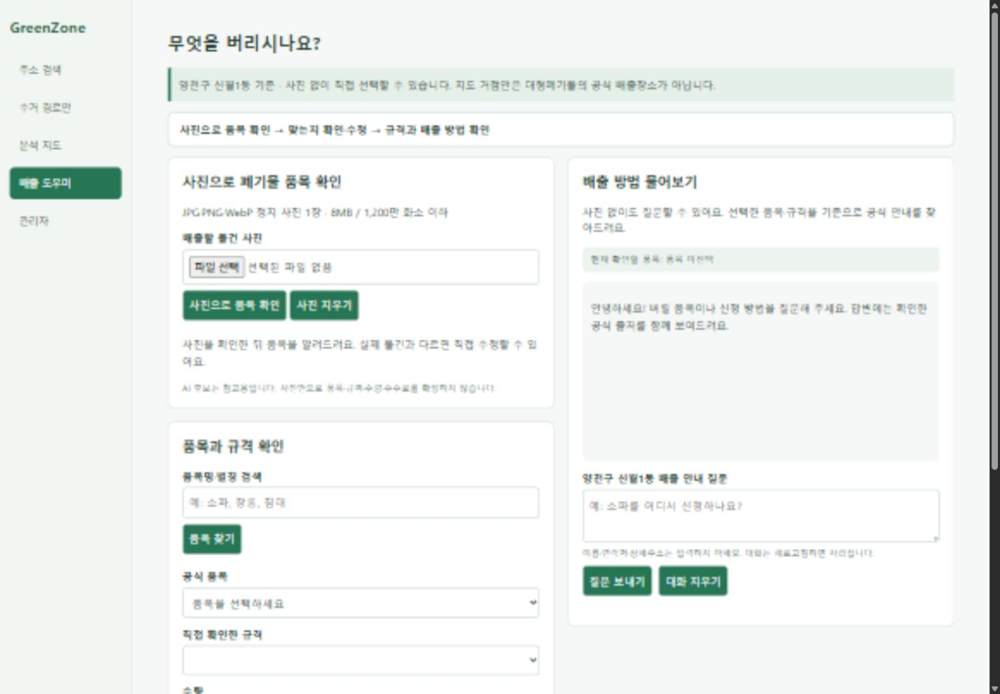

남은 작업은 독립 답변 평가, 다른 팀원 PC 실행 확인, 최종 발표 자료입니다. 관리자 보강 항목은 추가 작업으로 구분합니다.

### 실제 답변 내용 평가

[질문별 품질 평가](docs/RAG_QUALITY_EVALUATION.md) · [실제 답변 CSV](docs/rag_quality_evaluation_20261023.csv)

2026-10-23 고정 개발 질문 14건을 실제 호출하고 근거를 대조했습니다. 질문 충족 11건·부분 충족 3건이며, 이번 응답에서는 근거 없는 단정을 발견하지 못했습니다. **독립 평가나 전체 환각률을 뜻하지 않습니다.** 취소·환불, 도자기, 과태료 안내의 발췌 누락과 불필요한 재질문을 발견해 후속 항목으로 남겼습니다. Opik 기록 여부와 답변 내용의 적합성을 구분합니다.
