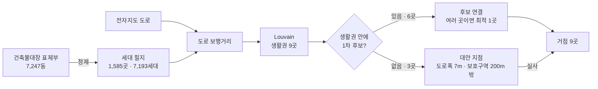

# 신월1동 그린존 2차: 도로 생활권으로 거점 수와 위치 정하기

> 작성 2026-10-20 · 데이터 분석 담당
> 입력: 1차 후보 11곳 (팀 엑셀 `greenzone1st.xlsx`) · 건축물대장 표제부 · 도로명주소 전자지도
> 원칙: **생활권 1곳 = 거점 1곳**

## 1. 결론

**신월1동은 걸어서 묶이는 생활권 9곳으로 나뉘므로, 그린존 거점은 9곳.**
6곳은 1차 후보로 바로 정했고, 후보가 없는 생활권 3곳(4, 6, 7)은 대안 지점을 찾아 팀이 실사로 부지를 확인한다.


| 생활권 | 세대 | 거점 | 구분 | 평균 보행 | 300m 안 | 400m 안 |
|---|---|---|---|---|---|---|
| 1 | 1,038 | 6번 양천구푸드뱅크마켓 신월점 및 50스타트센터 | **1차 후보** | 191m | 85% | 100% |
| 2 | 977 | 1번 곰달래 공영주차장 | **1차 후보** | 190m | 90% | 100% |
| 3 | 877 | 3번 신영시장 공영주차장 | **1차 후보** | 276m | 60% | 89% |
| 4 | 876 | 남부순환로57길 (남부순환로57길 23 앞 (5m)) | **대안 지점 · 실사** | 153m | 100% | 100% |
| 5 | 859 | 5번 신월1동독서실ㆍ파출소 | **1차 후보** | 197m | 82% | 95% |
| 6 | 708 | 곰달래로6길 (곰달래로6길 30 앞 (11m)) | **대안 지점 · 실사** | 219m | 74% | 100% |
| 7 | 691 | 곰달래로10길 (곰달래로10길 34 앞 (3m)) | **대안 지점 · 실사** | 129m | 100% | 100% |
| 8 | 585 | 7번 곰달래로13길 도로변 공터 | **1차 후보** | 158m | 99% | 100% |
| 9 | 582 | 10번 곰달래로5길 도로변 공터 | **1차 후보** | 236m | 67% | 99% |

| 지표 (1차 엑셀 기준 4~6) | 결과 |
|---|---|
| 보행 접근성 | 평균 **173m** · 300m 안 **95%** · 400m 안 **100%** (가장 가까운 거점까지) |
| 거점 커버리지 | 거점 1곳당 **582~1,038세대** (자기 생활권 기준) |
| 거점 총 개수 | **9곳**, 수거차 순회 **3.2km** (거점끼리 한 바퀴, 도로 기준) |

- 1차 후보 11곳을 모두 거점으로 써도 평균 212m · 300m 안 83%. **거점 수는 2곳 적지만 걷는 거리는 39m 짧음** → 후보가 동쪽·중앙 도로변에 몰려 있어서, 후보를 더 쓰는 것보다 빈 생활권을 채우는 것이 효과가 큼
- 예비 1차 후보: 2번, 4번, 8번, 9번, 11번 (같은 생활권에 더 가까운 후보가 있음. 거점 부지가 안 될 때 대체)

## 2. 전체 흐름



| 단계 | 질문 | 방법 | 코드 |
|---|---|---|---|
| ① | 누가 어디에 사나 | 표제부 세대수·가구수를 지번으로 건물에 연결 | `src/01_households.py` |
| ② | 얼마나 걸어야 하나 | 도로 중심선을 따라 걷는 거리 (직선 아님) | `src/02_walk_distance.py` |
| ③ | **거점이 몇 곳 필요한가** | Louvain으로 생활권 나누기 → 생활권 수 = 거점 수 | `src/03_louvain.py` |
| ④ | **어디에 두나** | 생활권 안 1차 후보 연결, 없으면 대안 지점 | `src/04_hubs.py` |

## 3. 데이터 정제: 표제부 → 세대 필지

생활권을 나누려면 "세대가 어디에 몇 세대 사는지"가 필요하다. 건축물대장 표제부의 건물별 세대수·가구수를 쓴다.

| 단계 | 건수 | 규칙 |
|---|---|---|
| 표제부 전체 | 7,247동 | 양천구 신월동(법정동) = 신월1~7동 전체 |
| 신월1동 건물만 | 1,788동 | 지번으로 전자지도 건물에 연결한 뒤 신월1동 경계 안만 (주거 건물 연결률 99.8%) |
| 아파트 제외 | −23동 | 기타용도에 '아파트' → 그 필지 20곳 전체 제외 (단지 자체 분리수거장이 있음) |
| 세대가 있는 건물 | 1,619동 | 세대 = 세대수 + 가구수 > 0 |
| └ 상가주택 포함 | 199동 (340세대) | 주용도가 근린생활시설이어도 세대·가구가 있으면 주민이 삶 |
| └ 0 → 1세대 보정 | 15동 | 주용도가 주택인데 세대·가구가 모두 0 (빈 값) |
| **세대 필지** | **1,585곳 · 7,193세대** | 같은 지번 건물을 합쳐 점 1개 (필지당 중앙값 3세대, 최대 69세대) |

**정제 규칙과 이유**
- **세대 = 세대수 + 가구수.** 표제부는 다세대·연립(공동주택)은 '세대수'에, 단독·다가구는 '가구수'에 값을 넣는다. 한 건물에는 사실상 둘 중 하나만 들어 있으므로 더하면 건물의 주거 단위 수가 된다. 다가구주택 1동에 5가구가 살면 배출 단위는 5이므로 '가구'도 세대로 센다
- **아파트 제외.** 아파트 단지는 단지 안에 분리수거장이 있어 그린존 대상이 아니다 (1차 분석 범위와 같음)
- **상가주택 포함.** 1층 상가·위층 주택 건물은 주용도가 '근린생활시설'로 등록되지만 세대가 산다. 주용도로만 거르면 340세대가 빠지므로 세대·가구가 있으면 포함했다
- **지번 연결.** 표제부 `시군구코드+법정동코드+대지구분코드+번+지` = 전자지도 건물 `SIG_CD+EMD_CD+LI_CD+MNTN_YN+LNBR_MNNM+LNBR_SLNO`
- **필지 단위로 합침.** 같은 지번의 여러 동(예: 다세대 A동·B동)은 한 점으로. 점 위치는 건물 도형 안의 대표점

**주택 구성**: 세대의 70%가 다세대·다가구. 1999년 이전 사용승인 건물에 사는 세대가 58% → 건물 안에 분리수거 공간을 새로 만들기 어려운 노후 저층 주거지라 거점 수거가 필요하다

| 주택유형 | 세대 | 비율 |
|---|---|---|
| 다세대 | 2,889 | 40% |
| 다가구 | 2,167 | 30% |
| 공동주택(기타) | 741 | 10% |
| 단독 | 676 | 9% |
| 연립 | 380 | 5% |
| 상가주택 | 340 | 5% |

## 4. 보행거리: 도로를 따라 걷는 거리

- 전자지도 도로구간 중심선을 교차점마다 끊어 그래프로 만들고(교차점 1,670개), 필지와 거점은 가장 가까운 도로에 수직으로 붙인 뒤 **최단 경로(다익스트라)** 로 거리를 잰다
- 직선거리로 재면 막힌 골목·블록을 무시하게 된다. 신월1동 필지 쌍의 도로거리는 직선거리의 **1.51배**(중앙값)
- 이후 모든 거리(생활권 연결, 평균 보행, 300m 안 비율)는 이 도로거리다

## 5. 거점 수 정하기: Louvain 생활권

### 5-1. 왜 Louvain인가

| 방법 | 거점 수를 정할 수 있나 | 이 문제에서 |
|---|---|---|
| K-means | 거점 수를 미리 넣어야 함 | 세대가 고르게 퍼져 있어 엘보우가 뚜렷하지 않음 → 수를 정하는 근거가 약함 |
| p-median | 거점 수를 미리 넣어야 함 | 정해진 수 안에서 위치를 고르는 데 적합 (수 자체는 못 정함) |
| **Louvain** | **데이터에서 묶음 수가 나옴** | 걸어서 서로 오가는 이웃끼리 묶어 생활권을 찾음 → 생활권 수 = 거점 수 |

### 5-2. 그래프 만들기

- **점**: 세대 필지 1,585곳
- **선**: 도로거리 **150m 안**에 있는 두 필지를 연결 (51,234쌍)
- **선의 강도**: `exp(−도로거리 / 75) × √(세대ᵢ × 세대ⱼ)`
  - 가까울수록 강함: 75m마다 약 1/e(37%)로 약해짐
  - 세대가 많은 필지끼리 강함: 많이 사는 곳일수록 생활권의 중심이 됨
  - 예) 100m 떨어진 5세대 필지 두 곳 → exp(−100/75) × √(5×5) = **1.32**

### 5-3. Louvain이 하는 일

modularity Q를 **최대화**하도록 필지를 묶는다.

$$Q = \frac{1}{2m} \sum_{i,j} \left[ A_{ij} - \gamma \frac{k_i k_j}{2m} \right] \delta(c_i, c_j)$$

- A_ij: 필지 i·j 사이 선의 강도, k_i: 필지 i에 붙은 선 강도의 합, m: 전체 선 강도 합, δ: 같은 생활권이면 1
- 말로 하면 **"같은 생활권 안의 연결이, 무작위로 이었을 때 기대되는 것보다 얼마나 더 촘촘한가"**. 생활권 안은 촘촘하고 생활권끼리는 느슨할수록 Q가 커진다
- 알고리즘: ① 각 필지를 이웃 생활권으로 옮겨 보며 Q가 커지면 옮김 → ② 생활권을 점 하나로 합쳐 ①을 반복 → Q가 더 안 커지면 멈춤
- γ(해상도) = **1**: 표준 modularity 그대로. 따로 조정하지 않음
- 시작 순서에 따라 결과가 조금 달라서 **20번 돌려 Q가 가장 큰 결과**를 씀 (재현 가능하도록 시드 고정)

**결과: 생활권 9곳, Q = 0.775.** 선 강도의 **90%가 생활권 안쪽**에 있다 (생활권끼리 오가는 연결은 10%). 20번 중 생활권 수는 9~10곳.

### 5-4. 왜 9곳인가 (검증)

연결 반경과 γ를 바꿔 18가지로 다시 나눠 봤다.


| 연결 반경 | γ 0.75 | γ 1 | γ 1.25 | γ 1 이상적 중심 300m 안 |
|---|---|---|---|---|
| 100m | 14곳 | 20곳 | 22곳 | 100% |
| 125m | 11곳 | 13곳 | 15곳 | 100% |
| 150m | 9곳 | **9곳** | 12곳 | 99% |
| 175m | 8곳 | 9곳 | 9곳 | 99% |
| 200m | 7곳 | 8곳 | 9곳 | 99% |
| 250m | 7곳 | 7곳 | 8곳 | 99% |

"이상적 중심" = 생활권마다 세대 보행거리 합이 가장 작은 필지에 거점을 둔다고 가정 (부지 조건 무시, 생활권 나누기가 보행 기준에 맞는지 확인용)

1. **반경 150m부터 생활권 수가 안정된다.** 150m 이상에서는 γ를 바꿔도 7~12곳. 반경을 줄이면(100·125m) 바로 옆 블록끼리도 끊겨 13~22곳으로 잘게 쪼개진다
2. **18가지 설정의 중앙값 9곳, 가장 많이 나온 값 9곳**
3. **9곳이면 보행 기준을 충족한다.** 생활권 중심에 거점을 두면 세대의 99%가 300m 안. 13곳 이상으로 늘려도 300m 안 비율은 거의 같다 (거점만 늘고 효과는 없음)
4. 150m는 걸어서 약 2분, '바로 옆 블록'까지의 거리다. 이보다 짧으면 골목 하나 건너 이웃도 다른 생활권이 된다

→ **거점 수 = 9곳**

## 6. 거점 위치 정하기

### 6-1. 생활권 영역

필지는 점이라 "후보가 생활권 안에 있나"를 보려면 영역이 필요하다. 동 안의 모든 지점을 **가장 가까운 세대 필지의 생활권**으로 칠했다 (필지 보로노이 → 생활권별로 합침 → 동 경계로 자름). 생활권끼리 겹치거나 빈 곳이 없다.

| 생활권 | 세대 | 필지 | 면적 | 안에 있는 1차 후보 | 판정 |
|---|---|---|---|---|---|
| 1 | 1,038 | 194 | 6.7ha | 6번, 4번 | 후보 연결 → 6번 |
| 2 | 977 | 221 | 7.9ha | 1번, 8번 | 후보 연결 → 1번 |
| 3 | 877 | 263 | 7.3ha | 3번 | 후보 연결 → 3번 |
| 4 | 876 | 167 | 7.8ha | 없음 | 대안 지점 탐색 |
| 5 | 859 | 183 | 8.4ha | 5번, 9번, 2번 | 후보 연결 → 5번 |
| 6 | 708 | 121 | 8.5ha | 없음 | 대안 지점 탐색 |
| 7 | 691 | 120 | 5.4ha | 없음 | 대안 지점 탐색 |
| 8 | 585 | 162 | 6.1ha | 7번, 11번 | 후보 연결 → 7번 |
| 9 | 582 | 154 | 4.7ha | 10번 | 후보 연결 → 10번 |

### 6-2. 1차 후보가 있는 생활권 → 연결

- 1차 후보 위치가 생활권 영역 안에 있으면 그 생활권과 연결
- 한 생활권에 후보가 2곳 이상이면 **그 생활권 세대의 평균 보행거리가 가장 짧은 후보 1곳**을 거점으로 (생활권 1곳 = 거점 1곳 원칙)
- 예) 생활권 5에는 5번, 9번, 2번이 있음. 생활권 세대의 평균 보행거리가 5번 197m / 9번 330m / 2번 332m → **5번을 거점**으로, 나머지는 예비로 둠

| 번호 | 이름 | 생활권 | 역할 | 그 생활권 세대 평균 보행 | 300m 안 |
|---|---|---|---|---|---|
| 6 | 양천구푸드뱅크마켓 신월점 및 50스타트센터 | 1 | **거점** | 191m | 85% |
| 4 | 신월1동저지2구역 공영주차장 | 1 | 예비 | 317m | 48% |
| 1 | 곰달래 공영주차장 | 2 | **거점** | 190m | 90% |
| 8 | 곰달래로14길 도로변 공터 | 2 | 예비 | 226m | 81% |
| 3 | 신영시장 공영주차장 | 3 | **거점** | 276m | 60% |
| 5 | 신월1동독서실ㆍ파출소 | 5 | **거점** | 197m | 82% |
| 9 | 곰달래로 도로변 공터 | 5 | 예비 | 330m | 47% |
| 2 | 곰달래로5길 공영주차장 | 5 | 예비 | 332m | 45% |
| 7 | 곰달래로13길 도로변 공터 | 8 | **거점** | 158m | 99% |
| 11 | 월정로 도로변 공터 | 8 | 예비 | 233m | 82% |
| 10 | 곰달래로5길 도로변 공터 | 9 | **거점** | 236m | 67% |

### 6-3. 1차 후보가 없는 생활권 → 대안 지점

생활권 4, 6, 7에는 1차 후보가 없다. 옆 생활권 후보를 쓰면 아래처럼 멀다.

| 생활권 | 가장 나은 기존 후보 | 그 후보로 평균 보행 | 300m 안 | 대안 1순위로 평균 보행 | 300m 안 |
|---|---|---|---|---|---|
| 4 | 10번 (옆 생활권) | 261m | 66% | **153m** | **100%** |
| 6 | 1번 (옆 생활권) | 285m | 63% | **219m** | **74%** |
| 7 | 1번 (옆 생활권) | 383m | 17% | **129m** | **100%** |

**대안 지점 기준** (도로 위 지점, 부지는 팀 실사로 확인)

| 순서 | 내용 | 남은 지점 |
|---|---|---|
| 1 | 신월1동 안 도로구간을 10m 간격으로 점을 찍음 | 1,780개 |
| 2 | **등록 도로폭 7m 이상** (5t 수거차 양방향 통행) | 690개 |
| 3 | **보호구역 대상시설 반경 200m 밖** (어린이·노인·장애인) | 521개 |
| 4 | 후보가 없는 생활권 영역 안 지점만 | 생활권별 4: 92개, 6: 20개, 7: 72개 |
| 5 | 각 지점에서 **그 생활권 세대의 평균 보행거리**를 계산해 짧은 순으로 1·2·3순위 | 순위끼리 60m 이상 떨어지게 |

- 1순위를 거점으로 두고 모든 지표를 계산했다. 실사에서 1순위 주변에 부지가 없으면 2·3순위로 내려간다
- 1차와 같은 기준(도로폭 7m, 보호구역 200m)을 썼으므로 부지만 확인되면 1차 후보와 같은 자격이 된다

| 지점 | 생활권 | 순위 | 접한 도로 (등록폭) | 가까운 건물 | 보호시설까지 | 교차로까지 | 생활권 평균 보행 | 300m 안 | 위도, 경도 |
|---|---|---|---|---|---|---|---|---|---|
| **A4-1** | 4 | 1 | 남부순환로57길 (7m) | 남부순환로57길 23 앞 (5m) | 454m | 5m | 153m | 100% | 37.534572, 126.831183 |
| A4-2 | 4 | 2 | 곰달래로5길 (17m) | 곰달래로5길 53 앞 (10m) | 380m | 6m | 165m | 92% | 37.534150, 126.832127 |
| A4-3 | 4 | 3 | 남부순환로57길 (7m) | 곰달래로1길 50 앞 (5m) | 458m | 3m | 173m | 100% | 37.533599, 126.830943 |
| **A6-1** | 6 | 1 | 곰달래로6길 (19m) | 곰달래로6길 30 앞 (11m) | 200m | 13m | 219m | 74% | 37.527541, 126.836273 |
| A6-2 | 6 | 2 | 곰달래로2길 (9m) | 곰달래로2길 42 앞 (7m) | 208m | 8m | 250m | 57% | 37.526745, 126.836035 |
| A6-3 | 6 | 3 | 곰달래로6길 (19m) | 곰달래로6길 38 앞 (10m) | 260m | 27m | 288m | 51% | 37.526816, 126.836731 |
| **A7-1** | 7 | 1 | 곰달래로10길 (8m) | 곰달래로10길 34 앞 (3m) | 343m | 5m | 129m | 100% | 37.527206, 126.837844 |
| A7-2 | 7 | 2 | 월정로13길 (7m) | 곰달래로10길 39 앞 (6m) | 309m | 25m | 141m | 100% | 37.526854, 126.838360 |
| A7-3 | 7 | 3 | 월정로13길 (7m) | 월정로13길 8 앞 (4m) | 256m | 27m | 155m | 100% | 37.526986, 126.839135 |

**실사 체크리스트**
- [ ] 지점 반경 50m 안에 수거함을 둘 공간(공터·공공부지·도로변 정차 공간)이 있는가, 소유는 누구인가
- [ ] 노상주차를 빼고도 차가 다닐 폭이 7m인가 (등록폭 기준이라 실제 유효폭 확인 필요)
- [ ] 교차로에 너무 붙어 있지 않은가 ('교차로까지' 15m 미만이면 교차로에서 떨어진 쪽으로 부지 탐색)
- [ ] 위성지도·로드뷰로 1차 확인 후 현장 방문
- [ ] **보호구역 경계에 붙은 지점**: A6-1(곰달래어린이집(어린이보호구역)까지 200.4m), A6-2(곰달래어린이집(어린이보호구역)까지 207.9m) → 부지는 보호시설 반대쪽에서 찾을 것

## 7. 평가: 다른 안과 비교

| 안 | 거점 수 | 평균 보행 | 세대 90%가 걷는 거리 | 200m 안 | 300m 안 | 400m 안 |
|---|---|---|---|---|---|---|
| 생활권 거점 9곳 (자기 생활권 거점 이용) | 9 | 195m | 335m | 56% | 84% | 98% |
| 생활권 거점 9곳 (가장 가까운 거점 이용) | 9 | 173m | 274m | 65% | 95% | 100% |
| 1차 후보 중 거점 6곳만 | 6 | 226m | 349m | 41% | 79% | 94% |
| 1차 후보 11곳 전부 | 11 | 212m | 336m | 47% | 83% | 95% |

- **자기 생활권 거점 이용** = 각 세대가 자기 생활권의 거점만 쓴다고 볼 때 (운영·홍보 단위). **가장 가까운 거점 이용** = 실제 주민 행동에 가까움
- 수거차 순회: 거점 9곳 3.22km, 1차 후보 11곳 2.89km. 대안 지점이 동 서쪽·남쪽 끝까지 퍼져 있어 순회가 조금 길지만, 거점이 2곳 적어 정차 횟수는 줄어든다

**참고: 후보가 있지만 생활권 한쪽에 치우친 곳**

원칙대로 생활권 안 후보를 거점으로 정했지만, 같은 방법으로 구한 생활권 최적 도로 지점보다 60m 이상 먼 곳은 아래와 같다. 실사 때 함께 보면 좋다.

| 생활권 | 연결된 거점 | 평균 보행 · 300m 안 | 생활권 최적 도로 지점 | 평균 보행 · 300m 안 | 차이 |
|---|---|---|---|---|---|
| 3 | 3번 신영시장 공영주차장 | 276m · 60% | 월정로29길 (월정로29길 14 앞 (5m)) | 175m · 96% | 102m |
| 9 | 10번 곰달래로5길 도로변 공터 | 236m · 67% | 월정로29길 (월정로29길 22 앞 (5m)) | 131m · 100% | 105m |

## 8. 한계

- 세대 수는 건축물대장 등록 기준이다. 빈집·실제 거주 인원은 반영하지 않는다
- 보행거리는 도로 중심선 기준이다. 경사·계단·횡단보도·일방통행은 반영하지 않는다
- 생활권은 세대 분포와 도로망만으로 나눴다. 시장·학교·정류장 같은 실제 동선은 반영하지 않는다
- 대안 지점은 등록 도로폭 기준이다. 노상주차 때문에 실제 유효폭이 7m보다 좁을 수 있다
- 수거 순회는 차고지 위치를 몰라 거점끼리 한 바퀴만 계산했다
- 상가(비주거) 배출량은 포함하지 않았다

## 9. 재현과 파일

```bash
pip install -r requirements.txt
python run_all.py          # 약 6분 (Louvain 민감도 18가지 × 20번)
```

기준값은 `src/gzlib.py` 맨 위 (`LINK_R`, `GAMMA`, `ROAD_MIN`, `PROTECT_R` …). 바꾸고 다시 실행하면 이 문서까지 다시 만들어진다.

| 파일 | 내용 |
|---|---|
| `greenzone2nd.geojson` | 거점 9곳 (웹 지도 메인 레이어, WGS84) |
| `greenzone2nd_layer_zones.geojson` | 생활권 9곳 영역 |
| `greenzone2nd_layer_candidates.geojson` | 1차 후보 11곳 + 연결된 생활권·역할 |
| `greenzone2nd_layer_alternatives.geojson` | 대안 지점 1~3순위 + 생활권 최적 도로 지점(참고) |
| `greenzone2nd_layer_households.geojson` | 세대 필지 점 (세대 수, 주택유형, 생활권) |
| `greenzone2nd.xlsx` | 요약 · 거점 · 1차 후보 연결 · 대안 지점 · 안 비교 · Louvain 민감도 · 세대 정제 · 가정 |
| `greenzone2nd.csv` | 거점 9곳 표 |
| `greenzone2nd_map.html` / `.png` | 지도 |
| `greenzone2nd_sensitivity.png` | 설정별 생활권 수와 보행 접근성 |
