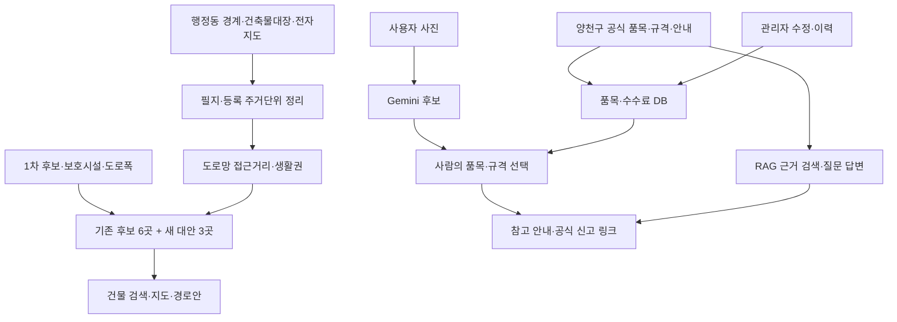

> **2026-10-23 구현 갱신:** 로컬 RAG 질문 API·임베딩 검색·구조화 답변·화면 출처 표시를 연결하고 실제 호출·브라우저에서 확인했다. 아래 최초 계획의 RAG 예정 부분은 이 구현 갱신을 우선해 읽는다. 개인정보가 있는 평가 원본·별도 충돌 진단과 다른 팀 PC 재현은 별도 남은 확인이다.

# 그린존 프로젝트 대서사: 문제·데이터·선택·검증의 전 과정

기준일: 2026-10-22 · 용도: 팀 합의, 발표 원고, 질의응답 준비 · 상태: **확장 초안**

**다음 작업은 [마무리 실행계획](REMAINING_TASKS.md)을 따른다.** 역할별 입력·결과물·완료 조건, 10/23~26 제안 일정, 질문10건, 발표 PDF 구성과 주말 코드 리뷰 순서를 구체화했다.

이 문서는 읽는 사람이 “왜 시작했는가 → 무엇을 근거로 선택했는가 → 어디까지 만들었는가 → 무엇이 아직 주장일 뿐인가”를 한 줄로 따라가도록 만든 기록이다. 문체는 이야기처럼 읽히게 쓰되, 숫자는 반드시 단위와 출처에 묶는다. 본문의 **확인 사실**은 자료에 적힌 내용, **팀 분석값**은 정해진 입력과 가정에서 계산한 값, **설계 판단**은 팀이 고른 구현 방향, **미확인**은 아직 검증되지 않은 조건을 뜻한다.

## 읽는 순서와 증거의 계급

| 표식 | 뜻 | 예시 | 발표에서 허용하는 표현 |
|---|---|---|---|
| F | 외부 원문에서 직접 확인 | 양천구 대형폐기물 신고 순서 | “양천구 안내에 따르면…” |
| A | 팀 데이터와 코드의 산출 | 9생활권, 담당점까지 평균 195.2m | “팀의 도로망 모형에서는…” |
| I | 실제 로컬 화면·요청에서 확인 | 사용자 선택 후 DB 금액 표시 | “로컬 시연에서 확인했다” |
| D | 자료와 결과를 바탕으로 고른 설계 | 사진은 후보만 제시하고 사람이 확인 | “이렇게 설계했다” |
| U | 아직 모르는 운영 조건 | 현장 유효폭, 부지 동의 | “현장 확인이 필요하다” |

발표 화면 한 장에 서로 다른 표식의 숫자가 섞이면 작은 주석으로 표식을 밝힌다. “효과가 있었다”는 표현은 운영 전후 실측값이 있을 때만 쓴다.

## 0. 먼저 합의할 한 문장

> 그린존은 신월1동의 아파트 제외 주거 필지를 대상으로, 주민 접근성과 수거 작업 조건을 함께 비교해 **운영 승인 전 거점안**을 보여주고, 주민이 자신의 건물을 검색해 담당 생활권을 확인하며 공식 배출 절차를 찾도록 돕는 교육용 웹 시연이다.

한 서비스 안에서 두 흐름이 만난다. **공간 분석**은 생활권·거점안을 설명하고, **배출 안내**는 공식 품목·규격·수수료 및 신고 절차를 설명한다. 대형폐기물 사진 후보는 사용자가 확인한다. 제안 거점이 곧 대형폐기물의 공식 배출장소라는 뜻은 아니다. 공식 신고와 장소·일시는 양천구 절차가 정한다. [양천구 대형폐기물 이용 안내](https://smartclean.yangcheon.go.kr/online/bulky/guide)

## 1. 발표의 주장은 어디까지인가

| ID | 발표 가능한 주장 | 직접 연결되는 근거 | 아직 말할 수 없는 것 |
|---|---|---|---|
| P1 | 배출 위치·시간과 수거 상황을 연결해 볼 필요가 있다. | 광주 동구의 방치·훼손·갈등 문제와 쓰레기 지도 사례가 2024년 통계청 사례집에 기록되어 있다. [원문](https://www.kostat.go.kr/boardDownload.es?bid=0053&list_no=434758&seq=2) | 신월1동에서도 같은 빈도로 발생한다는 주장 |
| P2 | 거점의 숫자와 위치는 주민의 실제 접근 부담을 함께 봐야 한다. | 제주도의회 2020년 검토자료는 도면상 반경 300m 이내 시설이 있어도 특정 이용자는 왕복 500m~1km가 필요했다고 기록한다. [원문 PDF](https://record.council.jeju.kr/CLRecords/Files/FileAppendix/a11/A031760.pdf) 4쪽 | 그 수치를 신월1동 설치 기준이나 현장 측정값으로 사용하는 것 |
| P3 | 설치 후 관리비와 기존 배출 방식의 관계까지 살펴야 한다. | 마포구의회 2016년 회의록은 재활용정거장 운영 후 기대했던 문전 혼합배출 감소가 나타나지 않았고 비용 때문에 축소·폐지를 검토했다고 기록한다. 시장 가격 하락이라는 외부 요인도 설명한다. [회의록](https://council.mapo.seoul.kr/record/recordView.do?key=2cebe62df6d5490879b695037bc3504950b91af3175c75f43aa99a2ee3ef343236603ed849ad8d81) | 정거장 자체가 혼합배출 증가를 일으켰다는 인과 주장 |
| P4 | 가까운 지역에도 유사한 시범 운영이 있었다. | 서울시 현장 기사는 2022년 화곡1동의 이동식 새로미 재활용 정거장과 자원관리사 운영을 소개한다. [현장 기사](https://mediahub.seoul.go.kr/archives/2006258?tr_code=new01) | 해당 사업의 현재 운영 여부·장기 성과 확정 |
| P5 | 지도·GPS·AI를 결합한 자원순환 선행 사례도 있다. | 통계청 2024년 사례집의 광주 동구 플랫폼. [원문](https://www.kostat.go.kr/boardDownload.es?bid=0053&list_no=434758&seq=2) | 그린존이 국내 최초 AI 폐기물 서비스라는 주장 |
| P6 | 공식 신고 절차와 분석 제안은 화면에서 분리해야 한다. | 양천구 공식 대형폐기물 안내는 신청, 장소·일시 입력, 품목 선택, 결제, 배출증 부착을 순서대로 설명한다. [공식 안내](https://smartclean.yangcheon.go.kr/online/bulky/guide) | 분석 거점에 대형폐기물을 임의로 배출해도 된다는 안내 |

**핵심 논리:** 선행 사례는 거점이 가능하다는 점과 동시에 주민 이동·관리 책임·비용을 검토해야 한다는 점을 보여준다. 그래서 그린존은 위치 하나를 정답으로 선언하지 않고 **동일 대상에 대해 여러 거점안을 비교**한다. 이 문장은 선행 자료와 팀 분석에서 도출한 *설계 판단*이다. 현장 효과의 증명은 아니다.

## 2. 우리가 실제로 한 일과 숫자의 의미

| 항목 | 현재 결과·구현 | 숫자를 읽는 법 | 내부 원본 |
|---|---|---|---|
| 범위·수요 | 신월1동, 아파트 제외 **1,585 주거 필지·7,193 등록 주거단위** | 건축물대장 세대수·가구수 가공 결과. 실거주자 수·실측 폐기물량 아님 | [팀 2차 분석](../greenzone_data_analysis/greenzone2nd/outputs/greenzone2nd/greenzone2nd.md), [웹 README](../README.md) |
| 생활권·거점안 | **9생활권·9거점안**, 기존 후보에서 선택한 6곳과 새 대안 3곳 | 1차 11곳을 단순히 도로 조건으로 9곳만 남긴 결과가 아님 | [팀 분석 지도](../greenzone_data_analysis/greenzone2nd/outputs/greenzone2nd/greenzone2nd_map.png) |
| 주민 이동 | 9곳의 **자기 생활권 담당 거점**: 평균 195.2m, 90백분위 334.8m, 300m 이내 등록 주거단위 84.1%; 6곳 비교안은 평균 226.1m, 90백분위 348.9m, 300m 이내 79.1% | 같은 팀 자료 안의 도로망 기반 비교. 실제 보행길·횡단·경사 검증 전이며 이용률도 아님 | [팀 결과표](../data/received/team_second_stage/greenzone2nd.xlsx), [화면 요약](../data/processed/team_second_stage_summary.json) |
| 수거차 경로 | 거점 방문 자동 순서·사용자 지정 순서, 등록 도로망 최단거리 표시 | 웹 경로안과 실제 차량 운행 실적은 다름. 정차·회차·일방통행·작업시간 미검증 | [경로 코드](../route_planner.py) |
| 배출 안내 | 공식 품목 91종·별칭 163개·규칙 268건을 조회하고 사진에서는 Gemini가 품목 후보 최대 3개를 제시 | 사용자가 품목·규격·수량을 확정. 금액은 2026-10-18 스냅샷의 참고값으로 최신 대조 필요 | [서비스 코드](../guide_service.py), [사진 후보 코드](../vision_service.py) |
| 관리자 | 공식 안내의 설명·출처·날짜 수정, 사용자 재조회 반영 및 이전/새 값 기록 | 로컬 SQLite에서 작동 확인. 구청 운영 시스템 아님 | [관리자 코드](../service_routes.py), [시연 기록](../data/vision/evaluation_20261022/service_verification.json) |

**계산하지 않은 효과:** 연료 절감, 실제 수거시간 단축, 사고 감소, 민원 감소, 배출량 절감, 운영비 회수. 기준선과 운영 실적이 없으므로 퍼센트 개선으로 발표하지 않는다. 과거 **신월1·2·3·5동 결합권역 배출량**을 신월1동이나 개별 거점의 관측 배출량으로 바꾸지 않는다. [공공데이터포털 원자료 소개](https://www.data.go.kr/data/15093944/fileData.do)

## 3. 왜 이 설계를 택했는가

### 3-1. 후보를 곧바로 ‘안전한 거점’이라 부르지 않는다

팀 분석은 등록 도로폭 7m 이상, 보호시설 대상점으로부터 200m 밖 등의 **비교 조건**을 쓴다. 7m·200m는 프로젝트 설정이며 법적 승인 기준이 아니다. 위성사진과 도로 데이터로 위치를 좁힐 수는 있지만 작업면 유효폭, 불법 주차, 후진 필요, 보행 연결, 부지 이용 동의는 현장·실무 협의가 필요하다. 따라서 발표 용어는 **거점 후보/분석 제안/확인 필요**로 통일한다. [팀 분석 방법](../greenzone_data_analysis/greenzone2nd/outputs/greenzone2nd/greenzone2nd.md)

### 3-2. 주소 검색과 사진 확인을 같은 사용자 경험에 둔다

주소 검색은 *내 건물이 어느 생활권에 속하는가*를 보여준다. 사진 또는 품목 검색은 *공식 절차로 무엇을 신고해야 하는가*를 돕는다. 두 결과를 한 서비스에서 보여주되, 제안 거점과 공식 대형폐기물 배출 위치를 섞지 않는다. 사진의 불명확한 규격을 AI가 결정하지 않는다. [사용자 흐름](../docs/screenshots/service_flow.svg)

### 3-3. 이미지 모델 선택은 작은 실험의 결과다

추가 비교는 **15장(실제 가구 12·합성 무물체 3) × 5방식 = 75회**였다. Gemini 단독과 DINO+Gemini는 모두 요청 15회 성공, 합성 무물체 3장에서는 후보 0건이었다. 처리시간 중앙값은 각각 **3.181초와 18.235초**였다. Gemini 단독도 정답 판정이 보류된 가구 5장 모두에 후보를 냈다. 따라서 후보가 떴다는 이유만으로 품목을 확정하지 않는다. 3종 YOLO 중 첫 모델은 무물체 3장 중 1장에 오제안을 냈다. 이 비교는 **독립 정답 15건의 정확도 실험이 아니다.** [비교 프로토콜](../data/vision/evaluation_20261022/evaluation_protocol.json), [집계](../data/vision/evaluation_20261022/summary_ko.json)

**선택:** 웹은 Gemini → 공식 품목 ID 재검사 → 사람이 품목·규격·수량 선택 → 공식 DB 조회. YOLO·DINO는 비교 근거로 보존하고 서비스의 선행 필터로 사용하지 않는다. 이는 이 표본과 현재 실행 환경에서의 선택이며 Gemini의 일반 정확도 우위를 증명하지 않는다.

### 3-4. RAG의 로컬 연결과 남은 평가

현재 배출 화면은 공식 품목·규격·수수료와 발췌 문서를 조회한다. **2026-10-22~23에 임베딩 검색·Gemini JSON 답변·사용자 질문 화면을 로컬에 연결했다.** 다음 단계는 검수한 양천구 배출 안내·관련 조례에 문서 ID, 출처 URL, 확인일, 시행일을 붙이고, 문서 검색 결과와 질문을 Gemini에 전달하는 것이다. 금액은 기존 규칙 DB에서 조회한다. 근거가 없거나 품목·규격이 모호하면 확인 질문 또는 보류를 보여준다. 법령은 절차의 배경 근거이고 요일·시간·금액의 단독 정답원이 아니다. [현재 남은 작업](../docs/REMAINING_TASKS.md), [공식 대형폐기물 안내](https://smartclean.yangcheon.go.kr/online/bulky/guide)

## 4. 검증의 증거와 한계

| 검증 질문 | 남아 있는 증거 | 결론 | 남은 확인 |
|---|---|---|---|
| 주민이 건물·거점안을 볼 수 있는가 | 주소·지도·생활권·경로 코드와 화면 | 기능 구현 | 주소 5건을 팀 원본과 재대조, 다른 PC 확인 |
| 사진 결과를 사람이 고칠 수 있는가 | 소파 사진→후보→사용자 선택→규격→참고 수수료의 로컬 시연 화면 | 해당 사례에서 동작 | 소파 외 독립 사진·사용자 선택률 |
| 관리자가 수정하면 안내가 바뀌는가 | 설명 수정→사용자 재조회→원복, HTTP 점검 18건 | 로컬 실행에서 확인 | 다른 PC 재현 |
| AI 답변이 공식 근거를 지키는가 | 품목 후보 실험 및 Opik 호출 기록 | 후보·보류·오류 관측 가능 | 질문 10건 정답·출처 대조 및 RAG 구현 후 평가 |
| 거점이 운영 가능하고 안전한가 | 등록 자료와 거리 계산 | 후보 검토 가능 | 현장 도로·작업면·보행·부지 동의·행정 승인 |

Opik 기록은 실행 관측 자료다. **환각률·정답률 자동 심사 완료**라는 뜻이 아니다. 현재 기능 점검과 외부 공공자료, 팀 분석 결과의 증거 수준을 섞지 않는다.

## 5. 팀이 붙여 넣어 쓸 발표 흐름

1. **문제:** 배출 시간·장소·관리 책임과 주민 접근성·수거 작업 조건을 함께 살펴야 한다. 외부 선행 사례를 신월1동의 발생 통계처럼 말하지 않는다.
2. **질문:** “신월1동 비아파트 주거지를 몇 개 생활권으로 나누고, 주민과 수거차가 받아들일 수 있는 거점안을 어떻게 비교할까?”
3. **데이터:** 행정동 경계, 건축물대장, 도로명주소 건물·도로, 보호시설, 공원·주차장, 공식 배출 규칙. 자료마다 기준일이 다르다.
4. **방법:** 필지의 등록 주거단위를 수요 대리값으로 사용하고, 도로망 접근 거리·거점 조건·9개 생활권을 비교한다.
5. **결과:** 1,585필지·7,193등록 주거단위, 9개 생활권과 9개 제안 거점. 자기 생활권 담당점 기준 평균 195.2m, 300m 이내 84.1%라는 *모형 결과*.
6. **서비스:** 건물 검색→담당 생활권·거점안·경로안, 사진/품목 검색→사람이 확인한 공식 품목·규격→수수료·출처. 관리자 자료 정정도 연결.
7. **검증:** 화면·서버 실동작과 실패 사례를 보여준다. RAG·현장 승인·실제 수거 효과는 남은 단계로 표시한다.
8. **결정:** 전면 설치 제안이 아니라 9개 후보의 현장 확인 우선순위와 공식 안내 연결 방식을 제안한다.

### 발표 첫 40초 원고

> “주택가 폐기물 문제를 단순히 수거함을 어디에 둘지로만 볼 수는 없습니다. 주민에게는 실제 걸어야 하는 거리와 배출 방법이 중요하고, 수거 작업에는 차량·보행·관리 조건이 함께 걸려 있습니다. 기존 거점 사업에서도 접근성과 운영비가 문제가 됐습니다. 그래서 저희는 신월1동의 비아파트 주거 필지를 대상으로 생활권과 거점안을 비교하고, 주민이 자기 건물을 검색해 분석안을 이해할 수 있는 웹으로 연결했습니다. 사진을 통한 대형폐기물 안내도 사람의 최종 선택과 공식 자료 조회를 거치게 했습니다. 오늘 보여드리는 거점과 경로는 운영 승인 전 제안이며 실제 효과는 현장 검증이 필요합니다.”

## 6. 발표 전에 채울 빈칸

| 우선 | 항목 | 채울 자료/완료 조건 | 담당 제안 |
|---|---|---|---|
| 1 | 공식 안내 최신성 | 시연 5품목의 현재 수수료·규격과 질문 10건의 원문·확인일·시행일 대조 | 분석 |
| 2 | 9개 거점 현장 조건 | 실제 도로 유효폭·정차·보행·보호시설·부지 관리 가능 여부를 확인/미확인으로 표기 | 분석 + PM |
| 3 | RAG | 기존 배출 화면에서 질문→검수 문서 검색→근거 답변/보류. 금액은 기존 DB | 개발 B + 개발 A |
| 4 | 재현 | 주소 5건·사진 시연·관리자 수정·지도/경로를 팀원 PC에서 확인 | 개발 A + PM |
| 5 | 발표 수치 | 팀 2차 분석 원본의 대상·단위·표 값과 슬라이드의 숫자를 대조 | PM + 분석 |

## 7. 출처 검토 기록

- **직접 다시 확인한 외부 1차 자료:** 통계청 2024 지역통계 사례집, 제주도의회 2020 검토자료, 마포구의회 2016 회의록, 서울시 2022 화곡1동 현장 기사, 양천구 공식 대형폐기물 안내, 공공데이터포털 양천구 자료 소개. 외부 사례는 문제 설정의 근거이며 신월1동 사업 효과의 증거가 아니다.
- **내부 분석 원본:** 팀 2차 분석 보고서·엑셀·GeoJSON과 현재 Git README. 수치의 단위·비교안은 그 원본을 따랐다. 외부 기관이 확정한 신월1동 운영안이 아니다.
- **실험·구현 기록:** `data/vision/evaluation_20261022/`의 프로토콜·집계·로컬 서비스 점검. 표본과 평가의 한계를 본문에 명시했다.
- **인용 보류:** 서대문구의회 PDF에서 전해진 강서구 후속 미추진 사유는 사용자 접근 가능한 원문을 재확보하지 못했다. 발표의 확정 사실로 쓰지 않는다. 효과·비용의 한계는 직접 확인한 마포구의회 회의록으로 설명한다.

## 8. 세부 자료 위치

- [팀 저장소 README](../README.md) — 현재 서비스, 데이터, 실행법
- [팀 2차 분석 결과](../greenzone_data_analysis/greenzone2nd/outputs/greenzone2nd/greenzone2nd.md) — 수요·생활권·거점 비교
- [요구사항과 진행표](../docs/GreenZone_Requirements_Status_20261022.xlsx) — 상태와 배당
- [ERD 안내](../docs/erd/README.md) — 논리 관계와 실제 SQLite 구분
- [남은 작업](../docs/REMAINING_TASKS.md) — RAG·평가·재현 순서

이 문서는 2026-10-22의 **발표 근거 지도**다. 출처의 새 버전이 나오거나 팀 분석안이 바뀌면 숫자·기준일·시연 화면을 함께 수정한다.

---

## 9. 서사의 시작: “집 앞에 내놓으면 되는데 왜 거점을 말하는가?”

이 질문이 프로젝트를 가장 날카롭게 시험한다. 양천구의 현재 배출 절차를 건너뛰고 주민에게 새로운 의무를 부과한다면, 위치 분석이 아무리 정교해도 서비스는 설득력을 잃는다. **그린존은 현재 배출 방식을 문제행동이라고 선언하지 않는다.** 지금의 제도와 별개로, 공동 배출 구역을 *가정했을 때* 주민 이동 부담과 수거 작업 조건이 어떻게 달라지는지 묻는다. 대형폐기물 화면은 더 분명하다. 주민은 양천구 공식 시스템에서 품목·장소·일시를 신고하고 결제해야 한다. 그린존의 지도 표시는 신고를 대체하지 않는다. [양천구 대형폐기물 안내](https://smartclean.yangcheon.go.kr/online/bulky/guide)

문제를 세 사람의 관점으로 나누면 설계 이유가 드러난다.

| 관점 | 실제로 묻는 질문 | 그린존이 지금 보여주는 것 | 운영 전에 더 필요한 답 |
|---|---|---|---|
| 주민 | “우리 집은 어디로 가야 하나? 무엇을, 언제, 어떻게 신고하나?” | 보유 주소 검색, 담당 생활권·제안 거점, 공식 품목·규격·참고 금액 | 새 배출 규칙 승인, 실제 장소·시간, 이동 취약 주민의 부담 |
| 수거 작업자 | “차가 들어오고 서고 나갈 수 있나? 작업 공간이 보행 동선과 겹치나?” | 등록 도로 자료, 후보 조건, 순회 경로안 | 차량 규격, 실제 도로 유효폭, 주정차, 회차, 일방통행, 야간 조건 |
| 운영 담당자 | “누가 설치하고 청소하고 민원을 처리하나? 정보가 바뀌면 누가 고치나?” | 출처·날짜가 붙은 자료, 관리자 수정·이력 | 부지 사용권, 유지비, 책임 주체, 행정·법률 검토 |

따라서 프로젝트의 질문은 “그린존을 설치하자” 하나가 아니다. **“설치 여부를 논의할 만큼 비교 가능한 자료를 만들었는가?”**다. 설치를 하지 않거나 일부 구간만 검토하는 결론도 분석의 유효한 결과다.

### 9-1. 선행 사례가 가르친 네 가지 다른 교훈

1. **광주 동구:** 쓰레기 지도, 청소차 위치, AI 배출함을 결합한 사례가 이미 있다. 우리가 주장할 차별점은 AI 자체의 최초성이 아니라 *신월1동의 건물별 접근성과 공식 배출 안내를 한 흐름에서 설명하는 방식*이다. [통계청 2024 사례집](https://www.kostat.go.kr/boardDownload.es?bid=0053&list_no=434758&seq=2)
2. **제주:** 클린하우스가 직선 반경 안에 있어도 실제 도보 왕복은 길어질 수 있다. 그래서 지도에 동그라미만 그리는 것으로 접근성을 설명하지 않는다. 다만 우리 도로 중심선은 보행자용 길 전체를 검증한 값이 아니므로 “실제 보행거리”라고 부르지 않는다. [제주도의회 검토자료](https://record.council.jeju.kr/CLRecords/Files/FileAppendix/a11/A031760.pdf)
3. **마포:** 새로운 정거장을 설치해도 기존 문전 혼합배출 감소가 자동으로 따라오지 않는다. 비용과 시장 여건이 운영을 흔든다. 그러므로 우리 분석의 수거 경로 길이만으로 비용 절감률을 말하지 않는다. [마포구의회 회의록](https://council.mapo.seoul.kr/record/recordView.do?key=2cebe62df6d5490879b695037bc3504950b91af3175c75f43aa99a2ee3ef343236603ed849ad8d81)
4. **화곡1동:** 가까운 주택가에서 이동식 정거장과 자원관리사를 함께 운영한 사례가 있다. 위치와 수거함 외에 사람의 안내·청결 관리가 붙어 있었다는 점이 중요하다. 도입 기사는 장기 운영 성공을 증명하지 않는다. [서울시 현장 기사](https://mediahub.seoul.go.kr/archives/2006258?tr_code=new01)

이 네 사례를 한 장의 비교 표로 발표한다면 “대상·수거 방식·관리 방식·알려진 한계·그린존에 반영한 질문” 다섯 칸으로 만든다. 성과 수치를 다른 지자체에서 그대로 가져와 신월1동 기대효과로 환산하지 않는다.

## 10. 분석의 여정: 11개 후보에서 9개 생활권·9개 제안점까지

### 10-1. 먼저 수요의 위치를 만들었다

팀의 2차 보고서는 양천구 신월동 건축물대장 표제부 **7,247동**에서 출발한다. 지번으로 전자지도 건물과 연결해 신월1동 경계 안 건물을 고르고, 아파트 필지를 제외한다. 세대수와 가구수를 주거단위로 합산하되, 상가주택처럼 주용도가 근린생활시설이어도 거주 단위가 있으면 포함한다. 주거용도에서 두 값이 0인 일부 건물은 팀 규칙에 따라 1로 보정한다. 같은 지번의 여러 건물은 필지 한 점으로 묶는다. 그 결과가 **1,585필지·7,193 등록 주거단위**다. [정제 단계와 건수](../greenzone_data_analysis/greenzone2nd/outputs/greenzone2nd/greenzone2nd.md)

여기서 7,193은 실거주자 수가 아니다. 각 주거단위에서 폐기물을 똑같이 배출한다는 실측값도 아니다. 분포를 비교하기 위한 *대리값*이며, 필지별 실제 폐기물 계량 자료가 생기면 교체할 수 있는 입력이다. 표제부의 누락·용도 혼합·0값 보정은 분석 결과에 영향을 줄 수 있으므로, 최종 제출 전 표본 필지를 원본과 대조한다.

### 10-2. 지도 위의 가까움과 걸어서의 가까움은 다르다

팀 코드는 도로 중심선을 교차점에서 나눈 그래프에 필지를 붙여 최단 경로를 계산한다. 보고서는 도로거리/직선거리의 중앙값을 **1.51배**로 기록한다. 이것은 *이 분석 대상의 모형 결과*다. 신호등 대기시간, 보행 통로의 폭, 경사, 계단, 횡단 가능 여부, 실제 출입구 위치를 모두 담은 보행 실측값이 아니다. [도로거리 분석](../greenzone_data_analysis/greenzone2nd/outputs/greenzone2nd/greenzone2nd.md)

### 10-3. 왜 9개 생활권인가

필지 간 도로거리가 **150m 안**일 때 연결하고, 거리와 등록 주거단위에 따라 연결 강도를 달리한 그래프에 Louvain을 적용했다. 기준 설정은 해상도 **γ=1**이다. 보고서에는 반복 실행과 다른 반경·해상도의 민감도 비교도 있다. 기준 설정에서 **9개**의 묶음이 나왔다는 사실과 “9곳이 행정·경제적으로 최선”이라는 결론은 구분한다. 생활권 수를 곧 거점 수로 두는 것은 팀이 선택한 계획 규칙이다. [생활권 분할·민감도](../greenzone_data_analysis/greenzone2nd/outputs/greenzone2nd/greenzone2nd.md)

### 10-4. 1차 11곳은 버리지 않았다

팀은 1차 후보 11곳을 9개 생활권에 놓았다. 기존 후보가 있는 생활권에서는 해당 생활권의 등록 주거단위에 대해 평균 접근거리가 짧은 후보 1곳을 택했다. **선정된 기존 후보는 6곳**이다. 선택되지 않은 후보 5곳은 해당 권역의 대체 위치로 남는다. 기존 후보가 없는 **생활권 4·6·7**에 한해 새 위치를 탐색했다. 따라서 9개 제안점은 **“11개 중 9개를 단순 탈락·잔존시켰다”는 결과가 아니다.** [후보별 역할](../greenzone_data_analysis/greenzone2nd/outputs/greenzone2nd/greenzone2nd.md)

대안 탐색은 도로 위 점을 만들고 **등록폭 7m 이상**, **보호구역 대상시설로부터 200m 밖**, **해당 생활권 안**이라는 조건을 건 뒤 접근거리로 순위를 정했다. 팀 보고서는 각 생활권의 1·2·3순위까지 적었다. 이 조건은 조사 대상을 줄이는 필터다. 특히 보고서의 “부지만 확인되면 같은 자격” 같은 문구는 발표에서는 더 신중히 표현한다. 부지뿐 아니라 정차·보행·소방·관리·행정 협의를 확인해야 한다. **생활권 4의 1순위는 교차로까지 5m, 생활권 7의 1순위도 5m**로 보고돼 있어 작업면과 시야를 먼저 확인할 필요가 있다. 이는 도로 단속 기준 판정이 아니라 현장 검토 우선순위에 관한 해석이다. [대안지점 속성표](../greenzone_data_analysis/greenzone2nd/outputs/greenzone2nd/greenzone2nd.md)

### 10-5. 결과 표에서 가장 중요한 분모

| 비교 조건 | 평균 거리 | 90백분위 | 300m 이내 비율 | 의미 |
|---|---:|---:|---:|---|
| 기존 후보 중 6곳 | 226.1m | 348.9m | 79.1% | 같은 팀 표의 비교 기준 |
| 9곳, **가장 가까운 곳** 이용 | 172.6m | 273.9m | 95.3% | 생활권 담당 규칙을 무시한 이론적 최근접 비교 |
| 9곳, **자기 생활권 담당점** 이용 | **195.2m** | **334.8m** | **84.1%** | 현재 웹의 담당 생활권 설명과 맞는 기준 |
| 1차 후보 11곳 전부 | 212.1m | 336.2m | 82.7% | 후보 수만 늘린 비교 |

표의 평균과 300m 이내 비율은 팀 분석의 **등록 주거단위 가중 도로망 결과**다. 9곳의 `172.6m·95.3%`는 **최근접 가정**이고, 화면의 권역별 담당 안내를 설명할 때는 `195.2m·84.1%`가 맞다. 어느 값을 발표하든 슬라이드에 이용 규칙을 적는다. 두 값을 바꿔 써서 개선폭을 키우지 않는다. [팀 원본 엑셀](../data/received/team_second_stage/greenzone2nd.xlsx)

수거차 순회에 관해 팀 보고서는 9거점 도로 순회 **약 3.2km**를 제시한다. 현재 웹의 자동·직접 순서 도구는 **별도로 받은 도로 162구간** 위에서 계산한다. 시작점·복귀·순서·도로 연결 가정이 다르면 두 숫자는 달라진다. 그 차이를 오류나 효율 개선으로 단정하지 않고, **팀 분석값과 웹 경로안의 산식·입력 차이**로 설명한다.

## 11. 서비스의 여정: 주민 한 사람과 담당자 한 사람

### 장면 A — 신월1동의 주민이 자기 건물을 찾는다

주민은 위치 권한 없이 보유 주소 또는 건물명으로 검색한다. 결과에서 자신의 건물을 선택하면 생활권, 담당 제안점, 지도 위 위치를 본다. 이 화면의 목적은 “오늘부터 이곳에 내놓으세요”가 아니라 **“현재 데이터와 분석 기준에서는 이 건물이 어느 제안 생활권에 배정되는가”**를 설명하는 것이다. 지도에서 후보지·필지·도로·보호시설 레이어를 켜고 끄면 위치 선정의 근거와 빈칸을 함께 볼 수 있다. 카카오 지도는 검색과 일반 지도 표시, Leaflet·Folium은 분석 지도 보기에 각각 사용된다. [서비스 구조](../README.md)

### 장면 B — 큰 가구를 버리려는 주민이 사진을 올린다

이미지를 보내면 서버가 파일 종류·크기를 확인하고 촬영정보를 제거해 축소한 뒤 Gemini에 품목 후보를 요청한다. 모델이 후보를 내더라도 버튼을 누르는 사람은 사용자다. “소파”를 선택한 뒤에도 인용 규격과 수량을 확인해야 DB의 참고 수수료가 나온다. 모르는 규격은 질문하거나 공식 목록을 다시 본다. 후보가 없거나 호출이 실패해도 직접 품목 검색으로 이어진다. [사진 처리·후보 코드](../vision_service.py), [이용 흐름 그림](screenshots/service_flow.svg)

양천구의 실제 신고에서는 신고자 정보, 장소·일시, 품목, 결제, 배출증 부착 절차가 이어진다. 그린존은 이 절차의 결제·예약을 대신하지 않는다. [양천구 공식 절차](https://smartclean.yangcheon.go.kr/online/bulky/guide)

### 장면 C — 주민이 이어서 묻는다: “그럼 언제 내놓나요?”

**이 장면은 로컬에 구현됐다.** 검수한 공식 문서에서 관련 문단을 찾고, 그 문단의 출처와 기준일을 붙여 설명해야 한다. 사진에서 사용자가 이미 확인한 품목과 규격은 질문의 맥락으로 활용할 수 있다. “이거”만 말해도 선택한 품목을 알 수 있지만, 배출 장소·일시는 주민의 신고 내용이 필요한 만큼 AI가 임의로 정하지 않는다. 문서가 오래됐거나 해당 조건이 없으면 “추가 확인 필요”를 반환한다. [남은 구현 계획](REMAINING_TASKS.md)

### 장면 D — 공식 안내가 바뀌면 담당자가 고친다

관리자는 원문과 날짜를 확인해 설명 또는 규칙을 수정하고 사유를 남긴다. 서버는 이전 값과 새 값을 이력에 기록한다. 주민 화면은 다시 조회하면 변경값을 읽는다. 이는 **정보의 변경 경로를 설명하는 로컬 시연**이다. 실제 지자체의 승인·배포·권한 체계를 갖춘 운영 시스템이라는 주장은 하지 않는다. [로컬 점검 기록](../data/vision/evaluation_20261022/service_verification.json)

## 12. 자료가 들어와 화면이 되기까지 — 연결도

| 데이터 묶음 | 누가 만들었나 | 현재 쓰는 곳 | 주의할 시점·단위 |
|---|---|---|---|
| 건축물대장 표제부·도로명주소 전자지도 | 국토교통부·행정안전부 원자료를 팀 분석에 활용 | 1,585필지·도로망·건물명/주소 | 원자료 생성일과 팀 결과 작성일을 분리 |
| 경계·보호시설·주차장·공원 | SGIS 기반 경계 및 공공데이터포털 자료 | 동 범위·후보 조건 | 공공 시설점 반경은 실제 법정 보호구역 도형과 다를 수 있음 |
| 팀 1·2차 결과 | 팀 분석 담당 | 11개 후보, 9생활권·9안, 지도 비교 | 계산 조건과 가정 고정 시의 모형값 |
| 생활폐기물 배출량 | 양천구 공개 결합권역 자료 | 배경 규모·참고 비교 | 신월1동 단독 관측량으로 분해해 주장하지 않음 |
| 대형폐기물 품목·수수료·배출 절차 | 스마트클린 양천의 확인 스냅샷 | 화면 품목·금액·공식 링크 | 시연 전 현재 목록·시행일 재대조 |
| 법령·조례·공식 안내 발췌 | 공식 원문 | 현재 발췌 조회, 다음 RAG 대상 | 발췌일·시행일·적용 지역 명시 |
| 이미지 비교 로그 | 팀 코드와 확장 비교 기록 | 모델 채택 이유 | 작은 표본, 독립 정확도 확정 불가 |

상세 파일별 출처·기준시점은 [데이터 목록](../data/data_inventory.csv), 팀 보고서의 처리 절차는 [팀 2차 결과](../greenzone_data_analysis/greenzone2nd/outputs/greenzone2nd/greenzone2nd.md)에 둔다. 이 문서는 원본을 다시 쓰는 문서가 아니라 **원본 사이의 주장 관계를 설명하는 문서**다.

## 13. 검증 질문 10개 — 발표와 RAG의 공동 평가표 초안

질문의 **기대 행동**은 지금 정하지만, 실제 정답 문구·금액·기준일은 원문을 다시 대조한 뒤 채운다. 평가에는 `질문 / 필요한 조건 / 정답 또는 보류 이유 / 공식 문서 ID·URL / 확인일 / 시행일 / 실제 응답 / 결과`를 남긴다.

| ID | 주민 질문 | 화면이 취할 행동 | 검증할 근거 |
|---|---|---|---|
| Q01 | 2인용 소파 1개는 얼마인가요? | 사용자가 2인용을 확인하면 DB 금액·출처를 표시 | 현재 공식 품목·규격 목록 |
| Q02 | 소파 2개면 얼마인가요? | **규격부터 질문**하고 확인 후 수량 계산 | 규격별 금액과 선택 수량 |
| Q03 | 침대 프레임과 매트리스를 같이 신고하나요? | 공식 분리 품목·절차를 설명하거나 원문 없으면 보류 | 품목표·공식 배출 안내 |
| Q04 | 크기를 모르는 장롱 사진으로 요금을 정해줘요. | 사진으로 금액을 확정하지 않고 측정/규격 선택을 요청 | 장롱 공식 규격 |
| Q05 | 이 밥상은 어떤 품목인가요? | 공식 후보를 보여주고 사용자가 선택 | 별칭·품목표 |
| Q06 | 서랍장을 수납장으로 잘못 골랐어요. 바꿀 수 있나요? | 품목을 다시 선택하고 규격·금액을 다시 조회 | 사용자 선택 UI와 공식 품목표 |
| Q07 | 신월1동에서 어디서 대형폐기물을 신청하나요? | 공식 신청 링크와 절차 표시 | 양천구 신청 안내 |
| Q08 | 신청한 소파를 언제·어디에 내놓나요? | 공식 일반 절차를 말하고 개인 예약의 장소·일시는 확인하도록 안내 | 양천구 배출 안내·신고 결과 |
| Q09 | 지도 거점에 소파를 두면 되나요? | 제안 거점의 미승인을 밝히고 공식 신고 절차로 안내 | 화면 제안 표시·양천구 절차 |
| Q10 | 신고 없이 내놓으면 과태료가 무조건 얼마인가요? | 조건과 상한의 차이를 말하고 임의 정액을 만들지 않음 | 공식 안내와 현행 조례 |

시연 품목 다섯 가지는 **소파·침대·장롱·밥상·서랍장**으로 고정해 준비한다. 이 선택은 다양한 실패 조건을 보여주기 위한 것이다. 소파는 정상 처리, 침대는 구성품, 장롱은 규격 부족, 밥상은 공식 명칭, 서랍장은 수납장 혼동을 맡는다. 이 다섯 품목의 현재 공식 목록·규격 존재 여부를 확인하기 전까지 “전부 자동 판정 가능”이라고 말하지 않는다.

### 평가를 수치로 만들 때 지켜야 할 분모

- **값 일치:** 답해야 하는 질문 중 DB·공식 자료의 값과 일치한 건수/그 질문 수.
- **근거 일치:** 답변에서 인용한 문서가 그 문장을 실제로 뒷받침한 건수/인용이 필요한 답변 수.
- **적절한 보류:** 정답 근거가 부족하거나 조건이 빠진 질문 중 보류 또는 확인 질문을 한 건수/그 질문 수.
- **시간·비용:** 동일 실행 조건에서 관측한 응답 시간과 실제 기록된 사용량만 보고.

서로 다른 분모를 합쳐 “정확도 하나”로 만들지 않는다. Opik은 추적·평가 결과를 남기는 곳이고, 근거가 실제로 맞는지는 사람이 대조한다.

## 14. 예상 반론과 답변의 근거

| 질문 | 짧은 답 | 보여줄 자료 |
|---|---|---|
| 집 앞 배출이 가능한데 왜 이동을 늘리나? | 새 방식의 의무화가 아니라 가정별 주민 부담·작업 조건 비교다. 이동이 과하면 그 안은 채택하지 않는다. | 현행 양천구 안내, 6/9/11곳 비교표 |
| 거점 9개는 누가 정했나? | 팀이 도로거리 그래프를 Louvain으로 9생활권으로 나누고 “생활권당 1곳” 규칙을 적용했다. 설정을 바꾼 민감도도 있다. | 팀 2차 보고서의 그래프·민감도 |
| 9개가 최적인가? | 선택한 지표·설정에서의 **제안**이다. 운영비·현장 공간·부지 동의를 함께 최적화한 확정값은 아니다. | 지표표와 미확인 조건표 |
| 11곳에서 9곳으로 줄인 것 아닌가? | 기존 후보 6곳을 선택하고, 후보가 없는 생활권 3곳에 새 대안을 만든 9곳이다. 다른 5곳은 예비 후보로 남는다. | 생활권별 후보표 |
| 도로폭 7m면 안전한가? | 등록폭은 탐색 조건이다. 실제 유효폭과 정차·보행·회차는 별도 확인해야 한다. | 대안 조건과 현장 점검표 |
| 수거차 경로가 3.2km라면 절감인가? | 팀 순회 모형값이다. 웹 경로는 별도 도로 입력을 쓰며 현재 운행 기준선이 없어 절감률은 산출하지 않는다. | 팀 경로표, 웹 경로 입력 설명 |
| AI가 소파를 틀리게 보면? | 후보만 표시하고 사용자가 품목을 선택한다. 틀리면 직접 검색한다. 금액은 확인된 품목·규격의 DB값이다. | 사진 후보 화면·오판 사례 |
| 그럼 RAG는 벌써 됐나? | 현재는 공식 발췌 조회와 출처 표시까지다. 문서 검색에 근거한 자유 질문 답변은 다음 구현이다. | 현재 `/disposal` 화면과 R1~R4 계획 |
| 법령까지 검색하면 답이 더 정확한가? | 배출 시간·금액은 현재 지자체 안내와 품목표가 우선이다. 조례는 필요한 법적 맥락에만 사용하고 시행일을 구분한다. | 공식 안내, 조례 원문·시행일 |
| 개인정보나 사진은 저장하나? | 현재 사진은 서버 파일·DB·Opik에 저장하지 않는 설계다. 외부 API 전송과 제공사의 처리 조건은 별도 고지 대상이다. | `vision_service.py`, 개인정보 화면 문구 |

## 15. 제출 직전의 편집 원칙

1. **한 슬라이드에 주장 하나.** 수치는 단위·분모·범위·기준일을 같이 적는다.
2. **모형과 화면을 연결한다.** 9생활권 그림 옆에는 검색한 건물이 어느 거점안으로 이어지는지 실제 캡처를 둔다.
3. **실패 사례를 숨기지 않는다.** 이미지 후보 오판과 근거 부족 보류는 설계 선택을 설명하는 핵심 증거다.
4. **완료 상태를 분리한다.** 자료 확보, Git 코드, 실제 로컬 동작, 다른 PC 재현, 현장 승인은 다른 상태다.
5. **출처가 없는 기대효과를 만들지 않는다.** “절감될 것이다” 대신 “운영 자료가 확보되면 이 지표로 비교한다”고 적는다.
6. **양천구 공식 절차를 우선한다.** 특히 대형폐기물의 품목·규격·수수료·신청·배출증은 시연 당일 다시 확인한다.
7. **인용 보류 자료는 주장에 싣지 않는다.** 후속 검토 PDF가 열리지 않는 강서구 사례는 발표 확정 근거에서 제외한다.

### 문서 변경 기록

| 날짜 | 변경 | 다음 검토자 |
|---|---|---|
| 2026-10-22 | 이전 추진 배경 조사, 팀 2차 분석, 웹 README, 모델 비교·로컬 점검을 하나의 주장 흐름으로 연결 | 분석: 숫자·출처 / 개발: 화면·코드 / PM: 주장 수위 |
| 2026-10-22 | 주민·작업자·운영자 관점, 11→9 선택 과정, 10개 질문, 반론·완료 기준을 상세화 | 같은 순서로 대조 후 표시 |

최종 발표 문구는 팀의 교차 검토 뒤 확정한다. 이 문서가 더 길어진 이유는 기능을 늘리기 위해서가 아니라, **각 선택을 나중에 다시 물어도 자료와 가정까지 되짚을 수 있도록** 하기 위해서다.

## 최종 제출 방향에 대한 추가 합의 (2026-10-22)

현재 확보한 자료의 범위에서 **1차 후보 기반6곳안과 2차 생활권9곳안을 비교하고, 주민 접근성을 기준으로 9곳안을 대표 추천**한다. 1차 발굴 후보 전체11곳, 비교에 사용한 기존6곳, 2차 제안9곳의 의미를 구분한다.

이번 프로젝트의 연결은 팀 분석 산출물을 실제 웹의 검색·지도·배정 안내에 반영하는 것으로 이미 구현했다. 현장 운영 실증을 새 완료 조건으로 요구하지 않는다. 검증은 팀 내부의 수치·출처·기능·재현 확인으로 한정해 보고한다.

도입에 관해서는 “이후 확인하면 된다”는 한 문장 대신 **후보 검토표 전달→관계자 조건 합의→시험 적용 범위 결정→운영 지표 기록→조정·확대 판단**의 액션플랜을 제시한다. 구체 순서는 [마무리 실행계획의 팀 합의 방향](REMAINING_TASKS.md#10-팀-합의-방향--가진-자료에서-마무리하기)에 둔다. 이 계획을 실제 승인·실증 성과로 표현하지 않는다.
