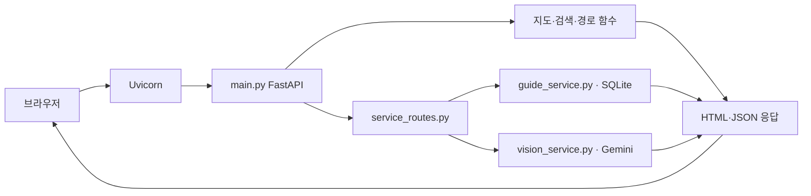

# 그린존 서버 실행과 배포 구성

이 폴더는 저장소를 받은 사람이 **실제 FastAPI 서버를 실행하는 진입점**이다. 현재는 개인 PC에서 실행하는 교육용 서버다. FastAPI는 웹 요청을 처리하고, Uvicorn은 그 앱을 실행하며, SQLite는 파일에 SQL 데이터를 저장한다. Docker는 실행 환경을 묶는 도구이고 AWS는 서버를 빌릴 수 있는 서비스다. SQL 데이터베이스와 각각 역할이 다르다.

## 1. 받은 뒤 실행하기

Windows PowerShell에서 다음 순서로 실행한다. 이미 받은 프로젝트는 그 폴더로 이동해 설치부터 진행한다.

```powershell
git clone https://github.com/Han-think/greenzone_ai.git
cd greenzone_ai
python -m venv .venv
.venv\Scripts\python.exe -m pip install -r server/requirements.txt
if (!(Test-Path .env)) { Copy-Item .env.example .env }
```

루트 `.env`를 열어 `.env.example` 설명에 따라 값을 넣는다. 실제 키와 비밀번호는 공유하지 않는다.

| 설정 | 기능 |
|---|---|
| `KAKAO_JAVASCRIPT_KEY` | 지도 표시. 카카오 앱의 허용 웹 도메인에 `http://localhost:8000` 등록 |
| `GEMINI_API_KEY`, `GEMINI_MODEL` | 사진 품목 후보. 키가 없으면 품목 직접 검색 |
| `ADMIN_USERNAME`, `ADMIN_PASSWORD` | 관리자 로그인. 비밀번호는 16자 이상 |
| `OPIK_ENABLED`와 Opik 설정 | 선택적 실행 기록. 없어도 기본 서비스 사용 가능 |

설정 후 프로젝트 루트에서 실행한다.

```powershell
.venv\Scripts\python.exe server/run.py
```

브라우저에서 **http://localhost:8000**을 연다. 관리자 주소는 `/admin`, 배출 안내는 `/disposal`, 분석 지도는 `/analysis`다. 종료는 실행한 터미널의 `Ctrl+C`다. 실행 중 서버 파일을 수정하면 종료 후 다시 실행한다.

기존 수업 방식으로도 같은 앱을 실행할 수 있다. 두 명령을 동시에 실행하면 8000 포트가 겹치므로 하나만 사용한다.

```powershell
.venv\Scripts\python.exe -m uvicorn main:app --host localhost --port 8000
```

이 문서의 새 파일이 Git에 반영되기 전에는 clone으로 이 진입 파일을 받을 수 없다. 로컬 초안 검토 후 커밋·공유하면 같은 방식으로 실행할 수 있다.

8000번이 사용 중이면 기존 서버를 실행한 터미널에서 종료한 뒤 다시 실행한다. 잠깐 HTTP 연결만 따로 확인할 때는 `server/run.py --port 8001`처럼 바꿀 수 있다. 카카오 지도는 해당 포트의 허용 도메인 등록이 별도로 필요하므로 **팀 기본 실행 주소는 8000**을 유지한다.

## 2. 서버에 실제로 들어가는 항목

서버는 **프로젝트 루트 전체를 기준으로 실행**한다. 기존 코드와 데이터를 다른 폴더에 복제하면 팀원 코드와 달라지므로 `server/run.py`가 루트의 `main:app`을 사용한다.

```text
greenzone_ai/
├── server/
│   ├── run.py                 # 실행 진입 코드
│   ├── rag_service.py         # 검수 문서 임베딩 검색·구조화 답변
│   ├── __init__.py            # 서버 패키지 표시
│   ├── requirements.txt       # 루트 패키지 목록을 참조
│   └── README.md              # 실행·저장·배포 설명
├── main.py                    # FastAPI 앱과 지도·검색 URL
├── service_routes.py          # 사진·품목·관리자 API
├── guide_service.py           # SQLite 조회·관리자 수정 이력
├── vision_service.py          # Gemini 품목 후보
├── route_planner.py           # 도로 경로안
├── folium_report.py           # Python 분석 지도
├── templates/                 # 사용자·관리자 HTML
├── static/                    # JavaScript·CSS
├── data/                      # 제공 분석 결과·지식 자료·생성 DB
├── requirements.txt           # 공통 설치 목록
└── .env                       # 각 실행 PC에서 준비, Git 제외
```

`server`만 복사해서 실행하는 구조는 아니다. 새 환경에서도 버전이 맞는 코드·데이터·화면을 함께 받는다. `data/raw`의 대용량 원본이나 학습 이미지는 웹 요청 때 학습에 사용되지 않는다. 웹은 팀의 가공 결과와 공식 안내 자료를 읽는다. 버전 확인을 하는 자료가 있으므로 데이터 일부만 임의 교체하지 않는다. [데이터 안내](../data/README.md)

## 3. 요청이 처리되는 순서



`@app.get` 또는 `@router.post`는 “이 주소와 요청 방식으로 들어오면 아래 함수를 실행한다”는 등록 코드다. `app.include_router`가 배출 안내·관리자 URL을 기존 앱에 합친다. 서버가 HTML과 JSON을 보내면 브라우저의 JavaScript가 지도와 결과를 표시한다. RAG 질문은 `POST /api/disposal/question`으로 받는다. `server/rag_service.py`가 검수 문서 검색·JSON 답변을 처리하고 화면은 답변과 실제 출처를 표시한다. 금액은 기존 DB를 사용한다.

## 4. SQL 데이터는 어디에 남는가

첫 배출 안내·관리자 조회 때 `guide_service.py`가 **`data/local/service.sqlite3`**를 만들고 초기 JSON 자료를 적재한다. 기존 DB가 있으면 관리자 수정값을 초기 데이터로 덮어쓰지 않는다.

| 실제 테이블 | 저장 내용 |
|---|---|
| `records` | 규칙·문서의 ID, JSON 본문, 수정 버전 |
| `history` | 수정 전/후 값, 사유, 담당자, 시각 |
| `seeds` | 초기 자료를 이미 넣었는지 확인 |

SQLite도 SQL 데이터베이스다. 현재는 별도 DB 서버 프로세스 없이 앱이 파일에 연결한다. 파일·이력의 관계는 [실제 DDL](../docs/erd/greenzone_current_sqlite.sql), 확장 설계는 [ERD 안내](../docs/erd/README.md)를 본다. 논리 ERD 11개 항목이 물리 테이블 11개로 만들어진 것은 아니다.

DB는 Git에서 제외되어 **새 PC에는 기존 PC의 관리자 수정값이 자동 전달되지 않는다.** 새 PC는 원본 JSON에서 시작한다. 관리자 수정 상태를 그대로 옮겨야 하면 기존 서버를 정상 종료한 뒤 DB 파일을 별도 보관하고, 대상 서버도 종료한 상태에서 같은 경로에 복원한다. 그 전에 대상 DB를 백업하고 공유 가능한 데이터인지 확인한다. 실행 중인 DB 파일을 단순 복사하는 방식은 사용하지 않는다.

사진은 현재 서버 파일·DB에 저장하지 않는다. 루트 `.env`와 `data/local/`은 서버별 로컬 상태이므로 저장소에 올리지 않는다.

## 5. 실제 외부 서버로 옮긴다면

이번에는 개인 PC에서 서버를 실행한다. 앞으로 외부 서버를 쓰려면 같은 저장소와 데이터 버전을 받은 뒤 Python·패키지·환경변수를 준비하고 앱을 실행하는 흐름을 사용한다. 다음 항목은 **향후 운영 준비 사항**이며 구현 완료 항목이 아니다.

| 항목 | 외부 서버에서 준비할 내용 |
|---|---|
| 실행 환경 | Python 버전·패키지 버전 확정, 서비스 자동 시작·재시작 |
| 접속 | 도메인·HTTPS·방화벽·역방향 프록시, 카카오 허용 도메인 변경 |
| 비밀 설정 | 서버 환경변수 또는 비밀 저장소에서 키·관리자 비밀번호 제공 |
| DB 지속성 | 배포 후에도 유지되는 저장 경로·백업·복구 |
| 로그인 | 현재 메모리 세션은 서버 재시작 시 종료. 현재 시연은 단일 프로세스 |
| 관측 | 오류·호출량·비용 기록과 API 사용 제한 |
| 자료 갱신 | 공식 자료 검수, 관리자 수정. 로컬 RAG는 변경 지문을 확인해 다음 질문 때 색인 갱신 |

PostgreSQL·MySQL로 바꾸려면 `guide_service.py`의 연결·SQL·트랜잭션과 자료 이관을 실제로 수정해야 한다. Docker 또는 AWS를 선택했다는 이유만으로 DB가 자동 전환되지는 않는다. 현재는 SQLite 단일 프로세스 시연을 기준으로 한다.

`localhost`는 본인 PC용이다. 같은 네트워크 접속을 허용하거나 인터넷에 공개하려면 바인딩 주소·방화벽·인증·카카오 도메인을 함께 검토해야 한다. GitHub에 코드를 올리는 것만으로 서버가 켜지지는 않는다.

## 6. 발표에서 사용할 설명

> “그린존은 개인 PC에서 FastAPI와 Uvicorn으로 서버를 실행했습니다. 지도·검색·사진 후보·배출 안내·관리자 기능을 같은 앱에 연결하고, 수정 자료는 SQLite에 저장합니다. 별도 실행 폴더를 두어 저장소를 받은 사람이 설치·환경 설정 후 같은 앱을 실행하도록 구성했습니다. 외부 서버 운영은 후속 단계이며, 도메인·HTTPS·DB 백업·실행 관리가 추가로 필요합니다.”

## 7. RAG 실행 확인

Gemini 키는 사진과 RAG에 함께 사용한다. `.env.example`의 `RAG_EMBEDDING_MODEL=gemini-embedding-001`이 기본값이다. 검수 문서가 바뀌면 다음 검색에서 자동 재구축하므로 매 질문마다 문서를 임베딩하지 않는다. `data/local/rag_index/`는 생성 자료이며 Git 제외다.

외부 호출 없이 핵심 계약을 확인하려면 프로젝트 루트에서 다음을 실행한다.

```powershell
.venv\Scripts\python.exe -m unittest discover -s scripts -p test_rag.py -v
```

실제 Gemini 호출은 `/disposal`의 질문 버튼으로 확인한다. 개인정보가 있는 평가 ZIP은 자동으로 읽거나 업로드하지 않는다.

구현 참고: [Google 임베딩 API](https://ai.google.dev/api/embeddings), [Gemini 구조화 출력](https://ai.google.dev/gemini-api/docs/structured-output).
